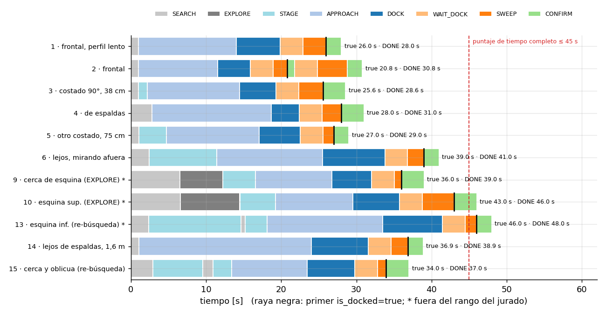
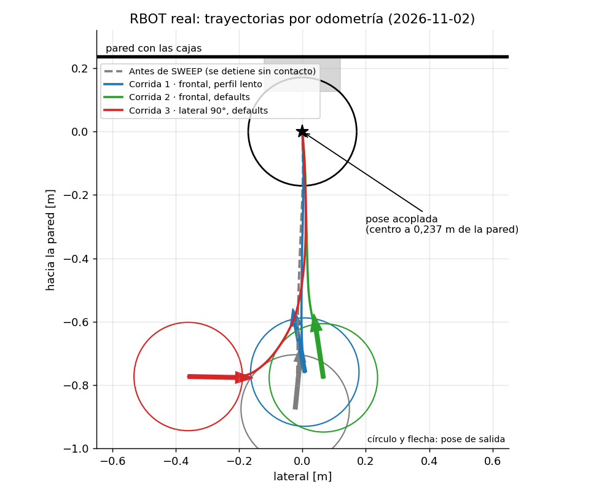
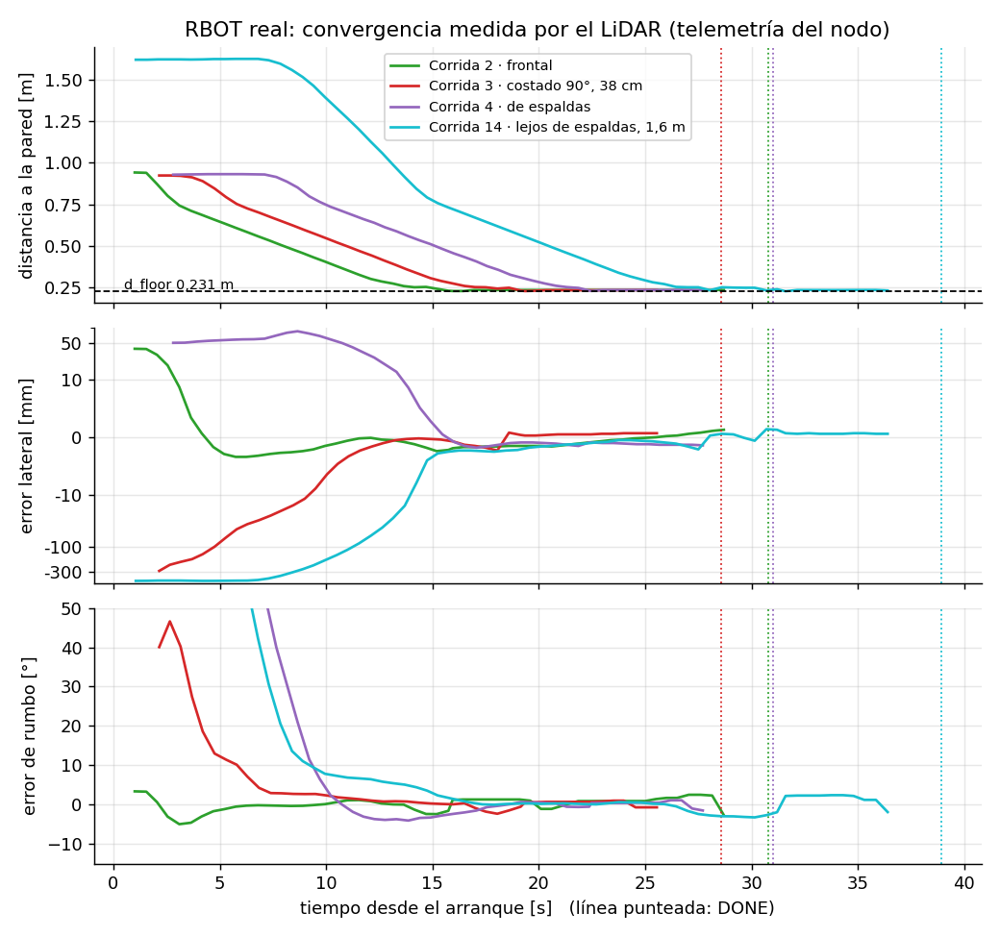
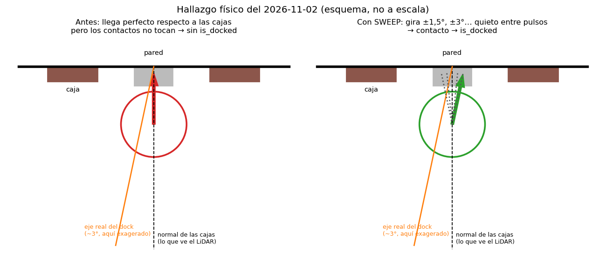
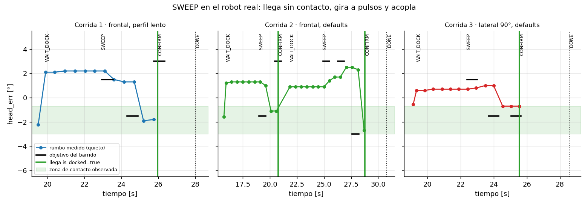
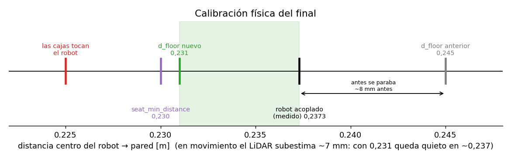
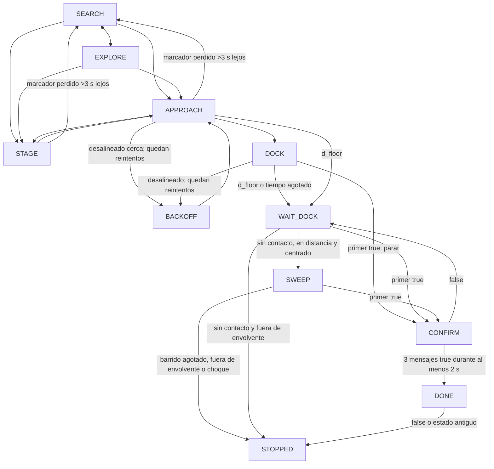

# terraslam_solucion_dock_lidar — Kalman Dock Challenge (HRFEST 2026)

La [bitácora del RBOT físico](docs/BITACORA_RBOT.md) reúne los cambios,
parámetros, pruebas, resultados conocidos y pendientes, y la siguiente pose.

**Estado al 2026-11-03: docking autónomo validado en el RBOT real.**
15 corridas físicas el 2026-11-02/03. **Dentro del rango del jurado: 8 de 8
acopladas**, con el primer `is_docked=true` entre 20,8 y 39,0 s (siempre
por debajo de los 45 s de puntaje de tiempo completo), desde frente, ambos
costados, de espaldas, lejos y en oblicuo. Fuera de rango (esquinas pegadas a
las paredes) acopló 3 veces; las 4 paradas de esas pruebas motivaron dos
cambios que ya están validados: **esperar quieto ante cortes de datos** y
**volver a buscar el marcador si se pierde lejos del dock**. El hallazgo clave
fue que **el dock físico está girado ~3° respecto a las cajas**; el estado
**SWEEP** lo resuelve sin fijar ningún ángulo. 98 pruebas sin movimiento
aprobadas. Detalle en [Resultados en el RBOT real](#resultados-en-el-rbot-real).

## Resultados en el RBOT real

Create 3 + RPLIDAR A1 del Kalman Lab, conexión remota (Husarnet/CycloneDDS).
Una corrida por autorización del operador. Logs, CSV del observador
(odometría, scans, `dock_status`, `cmd_vel`) y `RESUMEN.json` de cada una en
[`docs/pruebas/`](docs/pruebas/). Salvo la corrida 1, todas usan el launch **sin
argumentos** (configuración de entrega). Las poses de salida se midieron con
el LiDAR antes de arrancar cuando el marcador era visible; si no, se indican
por cámara cenital u odometría (aproximadas).

| # | Salida | Rango del jurado | Resultado (primer true · DONE) |
|---|---|---|---|
| [1](docs/pruebas/corrida-20261102-230721-ZFJy/RESUMEN.json) | frontal: 0,88 m · +14 mm · 11° (perfil lento `v_max` 0,08) | sí | **26,0 · 28,0 s**, carga ✔ |
| [2](docs/pruebas/corrida-20261102-231118-fZuv/RESUMEN.json) | frontal: 0,94 m · +38 mm · 6° | sí | **20,8 (fugaz) · 30,8 s** |
| [3](docs/pruebas/corrida-20261102-231607-RPdW/RESUMEN.json) | costado: 0,92 m · −377 mm · 93° (paralelo a la pared) | sí | **25,6 · 28,6 s** |
| [4](docs/pruebas/corrida-20261102-233133-eMLP/RESUMEN.json) | de espaldas (~180°) a ~0,93 m | sí | **28,0 · 31,0 s** |
| [5](docs/pruebas/corrida-20261102-233350-kHaz/RESUMEN.json) | otro costado: 0,86 m · +748 mm · −98° | sí | **27,0 · 29,0 s** |
| [6](docs/pruebas/corrida-20261102-233715-b6vJ/RESUMEN.json) | lejos: ~1,2 m · ~0,75 m · mirando hacia afuera | sí | **39,0 · 41,0 s** |
| [7](docs/pruebas/corrida-20261102-234435-A7gw/RESUMEN.json) | esquina superior, pegado a dos paredes | no | STOPPED 11 s: corte de `/odom` de 3,55 s |
| [8](docs/pruebas/corrida-20261102-235130-ywDq/RESUMEN.json) | misma esquina (ya con espera ante cortes) | no | STOPPED 17 s: LiDAR sin datos > 5 s |
| [9](docs/pruebas/corrida-20261102-235455-AP1n/RESUMEN.json) | a ~40 cm de esa esquina, sin ver las cajas | no | **36,0 · 39,0 s** (EXPLORE) |
| [10](docs/pruebas/corrida-20261103-000028-8tOB/RESUMEN.json) | esquina superior original, mirando a la esquina | no | **43,0 · 46,0 s** (EXPLORE) |
| [11](docs/pruebas/corrida-20261103-001028-NUn8/RESUMEN.json) | esquina inferior: 1,66 m · 1,72 m · 139° | no | STOPPED 10 s: marcador perdido > 3 s |
| [12](docs/pruebas/corrida-20261103-002052-ZgbH/RESUMEN.json) | misma (ya con re-búsqueda) | no | 2 re-búsquedas correctas; caída del nodo por un error de registro (corregido) |
| [13](docs/pruebas/corrida-20261103-002328-fYoW/RESUMEN.json) | misma esquina inferior | no | **46,0 · 48,0 s** (1 re-búsqueda) |
| [14](docs/pruebas/corrida-20261103-003137-5Jjj/RESUMEN.json) | lejos de espaldas: 1,62 m · −451 mm · −143° | sí | **36,9 · 38,9 s** |
| [15](docs/pruebas/corrida-20261103-003440-pY7O/RESUMEN.json) | cercana y oblicua: ~0,7 m · ~0,9 m · de lado | borde | **34,0 · 37,0 s** (1 re-búsqueda) |

En todas las corridas con DONE, `is_docked` seguía en true después de cerrar
el nodo. El operador verificó la carga física tras la corrida 1.



Las trayectorias por odometría, expresadas en el marco de la pose acoplada,
convergen al mismo eje y terminan en el mismo punto. La zona verde es el
rango de salida de las bases, trasladado a este marco. La línea gris
discontinua es la corrida anterior a SWEEP: llegó a la misma pose al
milímetro, pero sin contacto.



Lo que mide el propio nodo con el LiDAR en cuatro corridas representativas:
la distancia baja hasta `d_floor`, el error lateral converge a ±2 mm (escala
logarítmica: la corrida 14 empieza a 42 cm) y el rumbo a ±3° respecto a las
cajas.



**El hallazgo: el dock está girado respecto a las cajas.** El LiDAR no puede
ver el dock (es demasiado bajo), solo las cajas. Con el robot acoplado a
mano y cargando, su rumbo queda +2,6…+3,6° respecto a la normal de las cajas.
El robot llegaba perfecto respecto a las cajas y por eso no hacía contacto.



**SWEEP en acción.** En todas las corridas acopladas el robot llegó sin
contacto, esperó 3 s quieto y empezó a barrer. Las llegadas quedaron en
`head_err` +0,5…+2,6° y los contactos en −0,5…−3,0° (hipótesis consistente
con el dock girado; el barrido no la usa). El `true` llegó en el primer o
segundo objetivo negativo, entre 1 y 4 s después de empezar a barrer. En la
corrida 2 el primer `true` fue fugaz: CONFIRM no lo aceptó y el barrido
siguió. La figura muestra las tres primeras corridas.



**Calibración de la distancia final.** El tope anterior estaba 8 mm antes de
la posición acoplada; el nuevo `d_floor` queda entre la pose acoplada y el
contacto con las cajas.



**Robustez añadida tras las pruebas en esquinas.**

- *Cortes de datos (corridas 7 y 8).* En dos ocasiones dejaron de llegar
  `/odom` o los scans durante varios segundos (red inalámbrica; no se repitió
  en las corridas siguientes, que ya registraban cada scan). Antes, más de
  0,75 s sin datos paraba la corrida. Ahora el robot **se queda quieto**
  (ceros) hasta `data_gap_hold_s` = 5 s y, si los datos vuelven, espera 0,5 s
  y continúa en el mismo estado; si no, se detiene como antes.
- *Marcador perdido lejos (corrida 11).* A 1,2–1,6 m de la pared, girando o
  avanzando oblicuo, el detector perdía las cajas más de 3 s (pocos rayos por
  caja y sectores tapados por los postes del montaje del LiDAR). Antes eso
  paraba la corrida. Ahora, en `STAGE` o `APPROACH` con más de 0,6 m a la
  pared, **frena, olvida la estimación y vuelve a `SEARCH`**, como máximo
  `max_reacquire` = 3 veces. Nunca avanza hacia la estimación vieja. Cerca
  del dock se mantiene la parada. Validado en las corridas 12, 13 y 15: las
  cajas se recuperaron en 0,6–1,4 s.

Las figuras se regeneran desde los logs con `~/sim_ws/dev_tools/rbot/plots.py`
(fuera del paquete; no usa ROS).

Pendiente de ejercitar en el robot: el retorno al rumbo de un `true` fugaz
(implementado y cubierto por las pruebas sin robot; no volvió a aparecer un
`true` fugaz).

## En la competencia

### Qué ejecutar

La configuración validada en el RBOT es el launch **sin argumentos**:

```bash
source /opt/ros/humble/setup.bash
source ~/sim_ws/install/setup.bash
ros2 launch terraslam_solucion_dock_lidar solucion.launch.py
```

Antes de la primera corrida:

1. `colcon build --packages-select terraslam_solucion_dock_lidar` y las
   pruebas sin robot (`python3 -m pytest -q test`): deben pasar las 98.
2. Comprobar que llegan `/scan`, `/odom`, `/tf` y `/dock_status`
   (`ros2 topic hz /scan` ≈ 10 Hz) y que los relojes del PC y del robot están
   sincronizados: el nodo descarta mensajes con sellos de más de 0,75 s.
3. Un arranque sin movimiento:
   `ros2 launch terraslam_solucion_dock_lidar solucion.launch.py dry_run:=true`.
   Debe mostrar `LiDAR, TF y dock_status disponibles, arrancando` y
   `barrido=+-6.0 deg`. Cerrar con Ctrl-C.

En cada corrida del jurado:

1. El jurado coloca el robot. Lanzar el comando de arriba y no tocar nada.
2. Esperar `CONFIRM -> DONE` (en el RBOT, 21–39 s al primer `true` dentro
   del rango). El nodo mantiene ceros en DONE; cerrar con Ctrl-C.
3. Relanzar el proceso para la siguiente corrida: cada corrida empieza de
   cero, sin estado previo.

Si termina en `STOPPED`, el log dice por qué:

| Mensaje | Causa probable | Qué hacer |
|---|---|---|
| `... durante mas de 5.0 s` (odometría, LiDAR o dock_status) | Corte de red más largo que la espera | Revisar la conexión y relanzar |
| `marcador perdido durante demasiado tiempo` | Cajas perdidas cerca del dock o tras 3 re-búsquedas | Relanzar |
| `barrido de rumbo ... sin contacto` | Llegó al contacto sin `is_docked` en ±6° | Revisar que el dock no esté desplazado; relanzar |
| `esperando datos` al arrancar (15 s) | Falta algún tópico o la configuración DDS | Revisar la conexión antes de lanzar |

### Tiempo y velocidad

**Lo probado en el robot:** solo dos perfiles, el lento (`v_max` 0,08,
`v_fine` 0,04; corrida 1) y el de entrega (`v_max` 0,14, `v_fine` 0,05,
`w_max` 0,40; las otras 14). **No se probó ir más rápido.** El robot sí da
más: el límite que se respeta en todos los estados es 0,20 m/s y 0,50 rad/s,
y el nodo lo aplica aunque se pida más.

**Según las bases**, el tiempo vale 25 puntos y es completo si el promedio
de las corridas exitosas es de 45 s o menos. Dentro del rango ya estamos en
~30 s, así que acelerar no suma puntos con esa rúbrica y sí arriesga la
precisión (25) y el acople (50). Conviene **confirmar con los organizadores
cómo se puntúa el tiempo en la final presencial**: si se ordena por el más
rápido, vale la pena el perfil de abajo, pero solo después de validarlo.

**Dónde se va el tiempo** (salida frontal a ~1 m, primer `true` ≈ 26 s):

| Tramo | Velocidad | Duración aprox. |
|---|---|---|
| Búsqueda y giro inicial | `w_search` 0,3 / `w_max` 0,4 rad/s | 1–3 s (hasta 9 s si tiene que girar 150°) |
| Lejos (d > ~0,9 m) | `v_max` 0,14 m/s | 1–2 s |
| Tramo fino, 0,75 → 0,33 m | `v_fine` 0,05 m/s | ~8–10 s |
| Rampa, 0,33 → 0,237 m | `v_dock` 0,035 m/s | ~3 s |
| Espera parado antes del barrido | `dock_wait_s` 3 s | 3 s |
| Barrido hasta el contacto | pulsos de 0,3 rad/s | 1–4 s |

Subir `v_max` casi no cambia nada: el tramo fino domina.

**Perfil rápido (validado en el RBOT: 5 de 5)**, solo con argumentos del
launch, sin tocar el código:

```bash
ros2 launch terraslam_solucion_dock_lidar solucion.launch.py \
  v_fine:=0.07 d_fine:=0.60 dock_wait_s:=2.0 w_max:=0.5 w_search:=0.4 v_max:=0.18
```

Ahorro estimado antes de probarlo: ~5–7 s por corrida (tramo fino ~4,5 s,
espera 1 s, giros ~1 s); medido: 7,2 s de media. No toca `v_dock` ni
`d_floor`, que están calibrados juntos con el robot acoplado. Riesgos que se
vigilaron: menos tiempo para corregir el lateral y el rumbo antes de la
rampa, y más distorsión del scan al girar a 0,5 rad/s. El requisito fijado
antes de usarlo (5 corridas seguidas acopladas, incluidas de espaldas y
lejos, con la misma precisión) **se cumplió el 2026-11-03**.

Validación del 2026-11-03 (con `data_gap_hold_s:=10.0`), mismas poses que
la configuración de entrega:

| Pose | Entrega (primer true) | **Rápido (primer true · DONE)** | Lateral al llegar |
|---|---|---|---|
| frontal ~1 m | 20,8–26,0 s | **16,8 · 19,9 s** | 2,9 mm |
| de espaldas ~1 m | 28,0 s | **17,0 · 20,0 s** | 0,1 mm |
| lejos de espaldas (1,44–1,62 m) | 36,9 s | **25,0 · 27,0 s** | 1,0 mm |
| costado (~0,85 m, 66–75 cm a un lado) | 25,6–27,0 s | **28,0 · 31,0 s** | 0,1 mm |
| cercana y oblicua | 34,0 s | **26,0 · 29,0 s** | 0,5 mm |

**5 de 5 acopladas**, la misma precisión (≤ 2,9 mm y ≤ 1,8° al llegar) y
**7,2 s menos de media** al primer `true` (22,6 s frente a 29,7 s). En el
costado no ganó tiempo. Detalle en la [bitácora](docs/BITACORA_RBOT.md).
Si la final ordena por tiempo, este perfil es la opción recomendada:

```bash
ros2 launch terraslam_solucion_dock_lidar solucion.launch.py \
  v_fine:=0.07 d_fine:=0.60 dock_wait_s:=2.0 w_max:=0.5 w_search:=0.4 v_max:=0.18 \
  data_gap_hold_s:=10.0
```

**Perfil "turbo" (NO validado en el robot).** Dónde se va hoy el tiempo del
perfil rápido (media de sus 5 corridas, 22,5 s al primer `true`) y qué margen
queda:

| Tramo | Tiempo | ¿Se puede acelerar? |
|---|---|---|
| Búsqueda y colocación frente al dock | 4,5 s (hasta 9 s desde el costado) | No: ya gira a 0,50 rad/s, el tope de todos los estados. |
| Aproximación | 9,6 s | Algo: tramo fino más corto y más rápido. |
| Rampa | 4,8 s | No sin recalibrar: `v_dock` está calibrado junto a `d_floor`. |
| Espera antes del barrido | 1,8 s | ~0,5 s. |
| Barrido | 1,8 s | No: `dock_status` llega a 1 Hz. Empezar por el lado donde suele acoplar sería calibrar el ángulo de este dock. |

Candidato que exprime ese margen. Pasa la validación de parámetros y respeta
los límites en las pruebas sin robot; **ahorro estimado ~2–3 s más (≈20 s
de media), sin medir**:

```bash
ros2 launch terraslam_solucion_dock_lidar solucion.launch.py \
  v_fine:=0.09 d_fine:=0.50 dock_wait_s:=1.5 w_max:=0.5 w_search:=0.5 v_max:=0.20 \
  data_gap_hold_s:=10.0
```

Riesgos: menos recorrido para corregir el lateral y el rumbo antes de la
rampa (precisión) y entrada a la rampa más rápida. **Usarlo solo si se valida
5 de 5 en el robot** con la misma precisión que el perfil rápido (≤ 3 mm al
llegar), igual que se hizo con este, y solo si la final ordena por tiempo. Sin
esa validación, el perfil rápido es la opción. Por debajo del turbo no queda
margen sin superar 0,20 m/s y 0,50 rad/s o recalibrar la rampa con el robot
acoplado.

**Margen ante cortes de red:** en una red inestable conviene añadir
`data_gap_hold_s:=10.0` (máximo permitido): el robot espera quieto hasta 10 s
en vez de 5 antes de dar la corrida por perdida. El 2026-11-03 hubo un corte
de 8 s.

## RBOT físico: ajuste de la fase final

El launch y el nodo usan ahora la configuración de referencia del RBOT con
RPLIDAR A1: `use_sim_time=false`, `range_sigma=0.01`, `v_max=0.14`,
`v_fine=0.05`, `k_w=1.0`, `k_i=0.0`, `w_max=0.4`, `w_search=0.3`,
`d_fine=0.75`. El límite absoluto en todos los estados es **0.20 m/s y
0.50 rad/s**, incluido el retroceso. Se conserva el detector geométrico.

En el tramo final, la distancia al muro usa la mediana de los tres planos
recientes aceptados del LiDAR, transformados a odom y evaluados con la pose
actual. Así se compensa el movimiento desde cada scan y se evita detenerse
por el sesgo acumulado de la posición del eje en el Kalman. Lateral y rumbo
conservan el filtro y la ley de seguimiento existentes. Si faltan planos
recientes, se detiene. El log compara `d_filtro` y `d_lidar`.

**Calibración física (2026-11-02).** Con el robot acoplado a mano y cargando,
el centro queda a **0,2373 m** de la pared (σ = 0,19 mm). El tope anterior,
`d_floor=0.245`, paraba el robot antes del contacto; ahora es **0,231 m**:
más allá de la posición acoplada y antes de tocar las cajas (~0,225 m). En
movimiento la distancia por LiDAR se subestima ~7 mm (latencia ≈0,2 s a
0,035 m/s), así que con 0,231 el robot se detiene, ya quieto, en ≈0,237 m.
`v_dock` pasó de 0,025 a **0,035 m/s**, por encima del mínimo de 0,03 m/s que
declara el firmware.

Al llegar alineado a `d_floor`, pasa a **WAIT_DOCK**, publica ceros y
espera hasta 3 s. Si no llega `is_docked`, el robot está a la distancia de
contacto (≤ `d_floor` + 1,5 cm) y centrado (lateral ≤ 2 cm), entra en
**SWEEP**: gira en el sitio hacia rumbos +1,5°, −1,5°, +3°, −3°… hasta ±6°
respecto a la normal de las cajas. Cada objetivo se alcanza con **pulsos**
cortos (0,3 rad/s, 0,1–0,5 s) seguidos de **1,2 s quieto**, porque
`/dock_status` llega a 1 Hz y la latencia de la conexión remota haría pasarse
a un giro continuo: las decisiones se toman solo con el robot parado. El
primer `true` detiene el giro y pasa a CONFIRM. Si ese `true` resulta
fugaz, al reanudar vuelve primero al rumbo en que estaba **quieto** cuando
llegó (el estado llega con ~0,2 s de retraso), como máximo dos veces. Si agota el barrido (25 s
como máximo), se aleja del eje o recibe un choque, termina en STOPPED **sin
retroceder**. `v=0` en todo SWEEP. Desactivable con `dock_sweep:=false`. Los pulsos están desactivados por defecto (`max_seat_steps=0`):
el RBOT declara `min_speed=0.03 m/s` y los pulsos a 0.01 m/s no están
validados físicamente. Como opción experimental, **SEAT** permite hasta tres pulsos
rectos de 3 mm a 0.01 m/s, con esperas entre ellos, sin repetir el retroceso
largo hasta 0.62 m. El avance se limita por odometría y por tiempo
(`min(seat_timeout_s, seat_step/v_seat)`), con presupuesto de 9 mm por defecto
y tope absoluto de 10 mm. No continúa si `d <= 0.235 m`, el lateral supera
6 mm o el rumbo supera 3°. Alcanzar un límite, recibir un parachoques en esta
fase o agotar los pulsos acaba en parada, sin BACKOFF automático. La distancia
real de contacto queda pendiente de validar en el RBOT. El primer `is_docked=true`
detiene cualquier maniobra, incluso BACKOFF, y entra en **CONFIRM**: exige
al menos tres mensajes nuevos `true` que cubran 2 s consecutivos, parado.
Un `false` reinicia la confirmación; una muestra aislada no declara éxito.
DONE mantiene los ceros y vigila el contacto: si después se pierde o deja
de llegar el estado, pasa a STOPPED sin reanudar la marcha.

El arranque muestra los límites efectivos de la fase final. La telemetría de
WAIT_DOCK/SEAT incluye distancia actual y mínima observada, desplazamiento de
odometría desde la espera y pulsos realmente ejecutados. La parada distingue
el límite de distancia, el presupuesto de avance y los pulsos agotados: puede
bloquearse antes del primer pulso. Si después de STOPPED llegan lecturas true
estables, se informa como observación tardía, manteniendo la parada y sin
declarar exitoso el docking autónomo. Estar sobre la rampa no confirma carga;
la señal física debe verificarse con el robot encajado manualmente antes de
ajustar de nuevo las distancias de aproximación.

Hay como máximo dos reintentos adicionales por desalineación o choque durante
la aproximación, 12 s por recuperación y 180 s
por corrida. Si DOCK no progresa durante 12 s, también pasa a la espera
parado. Si en marcha dejan de llegar scans válidos o TF durante más de
0.75 s, o dock_status durante más de 2.5 s, el robot **se queda quieto**
hasta `data_gap_hold_s` (5 s): si los datos vuelven, espera 0,5 s y sigue;
si no, se detiene y hay que relanzar. Si pierde el marcador más de 3 s lejos
del dock (`STAGE`/`APPROACH`, más de 0,6 m), vuelve a buscarlo hasta
`max_reacquire` (3) veces; cerca del dock, la pérdida del marcador detiene la
corrida. Al arrancar espera datos hasta 15 s. Se
comprueban recepción y sellos de tiempo; el PC y el RBOT deben tener sus
relojes sincronizados. `/dock_status` usa QoS compatible con best effort.

Un launch y un nodo, tanto para comprobar sin movimiento como para ejecutar:

```bash
# Sin movimiento: toda salida cmd_vel es cero
ros2 launch terraslam_solucion_dock_lidar solucion.launch.py dry_run:=true log_level:=debug

# Corrida física, solo cuando el operador haya posicionado el robot
ros2 launch terraslam_solucion_dock_lidar solucion.launch.py log_level:=debug
```

Para Gazebo hay que indicar `use_sim_time:=true range_sigma:=0.001`.
Las métricas de simulación y las explicaciones históricas siguientes
corresponden a la versión anterior; no validan esta actualización física.

Pruebas de regresión sin contexto DDS, sin publicar a ningún robot:

```bash
source /opt/ros/humble/setup.bash
cd ~/sim_ws/src/terraslam_solucion_dock_lidar
PYTEST_DISABLE_PLUGIN_AUTOLOAD=1 python3 -m pytest -q -p no:cacheprovider test
```

Docking autónomo del iRobot Create 3 usando **solo el LiDAR**. El robot
reconoce las dos cajas marcadoras por su geometría, **triangula sus bordes**
con precisión sub-muestra, estima el eje del dock y la normal de la pared, y
se acopla en lazo cerrado hasta que `/dock_status` reporta `is_docked: true`.

| Resultado histórico en simulación (20 poses aleatorias del rango del jurado) | |
|---|---|
| Acoplamientos (sin choques) | **20/20** |
| Tiempo medio hasta `is_docked` | **16,7 s** (peor caso 18,9 s) |
| Error lateral medio | **0,10 mm** (peor caso 0,4 mm) |
| Error angular medio | **0,12°** (peor caso 0,24°) |

## Contenido

1. [Resultados en el RBOT real](#resultados-en-el-rbot-real)
2. [En la competencia](#en-la-competencia)
3. [Equipo](#equipo)
4. [Instalación y build](#instalación-y-build)
5. [Cómo correrlo](#cómo-correrlo)
6. [Parámetros del launch](#parámetros-del-launch)
7. [Cómo funciona](#cómo-funciona)
   - [Cómo sabe el LiDAR que esas son las cajas](#1-percepción-cómo-sabe-el-lidar-que-esas-son-las-cajas)
   - [Triangulación de los bordes](#2-triangulación-sub-muestra-de-los-bordes)
   - [Filtro de Kalman](#3-estimación-filtro-de-kalman-en-odom)
   - [Control](#4-control-en-el-frame-del-dock)
8. [Condiciones consideradas](#condiciones-consideradas)
9. [Validación histórica en simulación](#validación-histórica-en-simulación)
10. [Limitaciones conocidas](#limitaciones-conocidas)

---

## Equipo

| Nombre Completo | Correo |
|---|---|
| Patrick Fabrizio Echevarria Duran | patrick.echevarria.d@gmail.com |
| Marco Jesus Prado Vasquez | pradovasquezm@gmail.com |
| Camilo Roger Callupe Menejes | camilo.callupe.m@uni.pe |
| Viviana Ofelia Ventura Condo | viviana.ventura.c@uni.pe |

---

## Instalación y build

Requiere Ubuntu 22.04 y ROS 2 Humble. Para simulación, Gazebo Classic 11 y el escenario
[`create3_dock_challenge`](https://github.com/Kalman-Robotics/create3_dock_challenge)
en el mismo workspace. La única dependencia extra es **NumPy**, declarada en
`package.xml` e instalada por rosdep.

```bash
cd ~/sim_ws/src
git clone https://github.com/Kalman-Robotics/create3_dock_challenge.git
git clone <este repositorio> terraslam_solucion_dock_lidar

cd ~/sim_ws
source /opt/ros/humble/setup.bash
rosdep install --from-paths src --ignore-src -r -y
colcon build --symlink-install
source install/setup.bash
```

---

## Cómo correrlo

### Comando único

```bash
# Terminal 1: el escenario del reto (sin tocar)
ros2 run create3_dock_challenge clean_sim.sh
ros2 launch create3_dock_challenge challenge_world.launch.py

# Terminal 2: la solución
ros2 launch terraslam_solucion_dock_lidar solucion.launch.py use_sim_time:=true range_sigma:=0.001
```

El nodo arranca solo. El ejemplo anterior es para Gazebo. En el RBOT físico,
el comando sin esos dos argumentos usa los valores por defecto descritos al
inicio; después del acoplamiento confirmado mantiene ceros.

### Ejemplo de salida con contacto estable

Ejemplo ilustrativo de la versión actual; los tiempos no son una medición
de éxito físico de esta revisión.

```
[dock_lidar]: dock_lidar listo | /scan -> /cmd_vel a 20 Hz | v_max 0.14 m/s, w_max 0.40 rad/s, v_fine 0.050, v_dock 0.035 | range_sigma 0.010 m
[dock_lidar]: LiDAR, TF y dock_status disponibles, arrancando
[dock_lidar]: [  1.00s] SEARCH -> APPROACH
[dock_lidar]: [ 20.00s] APPROACH -> DOCK
[dock_lidar]: is_docked=true recibido durante DOCK
[dock_lidar]: [ 23.00s] DOCK -> CONFIRM
[dock_lidar]: [ 25.00s] CONFIRM -> DONE
[dock_lidar]: acoplamiento confirmado parado: 3 lecturas, 2.00 s estables
```

La primera línea resume la configuración efectiva: conviene revisarla antes
de cada corrida.

### Otras formas útiles

```bash
# Ver todos los argumentos con su descripción
ros2 launch terraslam_solucion_dock_lidar solucion.launch.py --show-args

# Telemetría del control cada 0,5 s: distancia a la pared, error lateral,
# error de rumbo, lookahead y velocidad
ros2 launch terraslam_solucion_dock_lidar solucion.launch.py log_level:=debug
#   d=0.371 e=-5.0mm head=+0.00deg L=0.06 v=0.050

# Probar desde otra pose (en la terminal del escenario)
ros2 launch create3_dock_challenge challenge_world.launch.py x:=1.3 y:=0.9 yaw:=1.0

# RBOT físico con el RPLIDAR A1
ros2 launch terraslam_solucion_dock_lidar solucion.launch.py use_sim_time:=false range_sigma:=0.01
```

En RViz: **Add → By topic → `/dock_lidar/markers`** muestra las cajas
detectadas (naranja) y el eje estimado del dock (cian).

---

## Parámetros del launch

Cada argumento del launch es un parámetro del nodo con el mismo nombre. Las
distancias `d_*` se miden **desde la pared detectada, a lo largo de su
normal**, nunca en coordenadas del mundo.

### Entorno e interfaces

| Argumento | Defecto | Descripción |
|---|---|---|
| `use_sim_time` | `false` | `false` en el robot real; `true` para Gazebo. |
| `dry_run` | `false` | `true` evalúa las decisiones publicando solo ceros. |
| `scan_topic` | `/scan` | LaserScan de entrada. |
| `cmd_vel_topic` | `/cmd_vel` | Twist de salida. |
| `dock_status_topic` | `/dock_status` | Solo se lee `is_docked`. |
| `odom_frame`, `base_frame` | `odom`, `base_link` | Frames de TF. |
| `publish_markers` | `true` | Markers de depuración para RViz. |
| `control_rate_hz` | `20.0` | Frecuencia del control y de `/cmd_vel`. Mínimo 5 Hz: el Create 3 se detiene si no recibe comandos seguido. |
| `log_level` | `info` | `debug` activa la telemetría del control. |

### Percepción

| Argumento | Defecto | Descripción |
|---|---|---|
| `range_sigma` | `0.01` | Ruido del LiDAR [m]. 0,01 como referencia del A1; 0,001 en simulación. |
| `max_scan_range` | `6.0` | Ignora lecturas más lejanas [m]. |

### Velocidades

| Argumento | Defecto | Descripción |
|---|---|---|
| `v_max` | `0.14` | Velocidad lineal máxima [m/s], limitada siempre a 0,20 por Kalman. |
| `w_max` | `0.4` | Velocidad angular máxima [rad/s], limitada siempre a 0,50 por Kalman. |
| `v_fine` | `0.05` | Velocidad en el tramo fino [m/s]. |
| `v_dock` | `0.035` | Velocidad sobre la rampa [m/s]; ≥ 0,03, mínimo del firmware. |
| `v_seat` | `0.01` | Velocidad de asentamiento recto, limitada a 0,01 m/s. |
| `v_backoff` | `0.12` | Velocidad de retroceso al reintentar [m/s]. |
| `w_search` | `0.3` | Giro de búsqueda [rad/s]. |

### Ganancias y geometría de la maniobra

| Argumento | Defecto | Descripción |
|---|---|---|
| `k_w` | `1.0` | Ganancia proporcional de rumbo. |
| `k_i` | `0.0` | Ganancia integral de rumbo (desactivada en el RBOT). |
| `d_fine` | `0.75` | Inicio del tramo fino [m]. |
| `d_slow` | `0.42` | Desde aquí se exige alineación; si no, retrocede y reintenta [m]. |
| `d_dock` | `0.33` | Inicio del tramo de rampa [m]. |
| `d_floor` | `0.231` | Distancia de parada para esperar dock_status [m]. Calibrada: acoplado = 0,2373 m. |
| `d_stage` | `0.75` | Punto de preparación sobre el eje [m]. |
| `align_tol_lat` | `0.025` | Error lateral máximo al pasar `d_slow` [m]. |
| `align_tol_head_deg` | `15.0` | Error de rumbo máximo al pasar `d_slow` [°]. |

### Choques (`/hazard_detection`)

| Argumento | Defecto | Descripción |
|---|---|---|
| `hazard_topic` | `/hazard_detection` | `HazardDetectionVector`; solo se usa el tipo `BUMP`. |
| `react_to_bumps` | `true` | Ante un choque: retroceder recto (`ESCAPE`) y reintentar. |
| `bump_escape_s` | `0.8` | Duración del retroceso recto tras un choque [s]. |
| `max_bump_retries` | `3` | Límite de recuperaciones por choque; también cuenta el presupuesto total de reintentos. Después se detiene. |

### Barrido de rumbo en el contacto (`SWEEP`)

| Argumento | Defecto | Descripción |
|---|---|---|
| `dock_sweep` | `true` | Sin `is_docked` en la distancia de acople: barrido de rumbo por pulsos. |
| `sweep_max_deg` | `6.0` | Amplitud máxima respecto a la normal de las cajas [°] (máximo 10). |
| `sweep_step_deg` | `1.5` | Paso entre objetivos [°]. Orden: +1, −1, +2, −2… pasos. |
| `sweep_w` | `0.3` | Giro de cada pulso [rad/s]. ≥ 0,26: más lento, las ruedas quedan bajo 0,03 m/s. |
| `sweep_hold_s` | `1.2` | Pausa quieto tras cada pulso; dock_status llega a 1 Hz [s]. |
| `sweep_tol_lat` | `0.02` | Error lateral máximo para iniciar el barrido [m]. |
| `sweep_timeout_s` | `25.0` | Duración máxima del barrido [s]. |

### Búsqueda, exploración y final

| Argumento | Defecto | Descripción |
|---|---|---|
| `start_delay_s` | `1.0` | Espera inicial [s]. |
| `search_turn_deg` | `90.0` | Giro en `SEARCH` antes de explorar [°]. |
| `explore_step` | `0.8` | Paso máximo de `EXPLORE` [m]. |
| `explore_timeout_s` | `8.0` | Tiempo máximo por paso de `EXPLORE` [s]. |
| `obstacle_clearance` | `0.45` | `EXPLORE` se detiene si hay algo a menos de esto por delante [m]. |
| `dock_push_s` | `0.0` | Obsoleto e ignorado; no se empuja durante la confirmación. |
| `dock_confirm_s` | `2.0` | Tiempo de lecturas true consecutivas, con al menos tres mensajes nuevos [s]. |
| `dock_wait_s` | `3.0` | Espera parado antes del siguiente pulso de asentamiento [s]. |
| `seat_step` | `0.003` | Avance máximo por pulso final [m]. |
| `max_seat_steps` | `0` | Pulsos experimentales desactivados por defecto; después STOPPED, sin retroceso largo. |
| `seat_min_distance` | `0.230` | Distancia mínima para continuar asentando [m]; debe ser < `d_floor`. |
| `seat_timeout_s` | `0.6` | Límite por pulso; también se limita por `seat_step/v_seat` [s]. |
| `seat_tol_lat`, `seat_tol_head_deg` | `0.006`, `3.0` | Alineación exigida para el asentamiento [m, °]. |
| `dock_timeout_s` | `12.0` | Tiempo máximo de avance en DOCK antes de esperar parado [s]. |
| `max_dock_retries` | `2` | Reintentos adicionales al primer intento, compartidos con los choques. |
| `retry_timeout_s` | `12.0` | Tiempo máximo por recuperación [s]. |
| `scan_timeout_s`, `tf_timeout_s` | `0.75` | Edad máxima de scan y TF [s]. |
| `detection_timeout_s` | `3.0` | Tiempo máximo sin detectar el marcador [s]. |
| `max_reacquire` | `3` | Marcador perdido lejos del dock (`STAGE`/`APPROACH`, d > 0,6 m): parar, olvidar la estimación y volver a `SEARCH`, como máximo estas veces; `0` = parar. |
| `data_gap_hold_s` | `5.0` | Corte de odometría, LiDAR o `dock_status` en marcha: esperar quieto hasta este tiempo y seguir si vuelven; `0` = parar al instante. Máximo 10. |
| `dock_status_timeout_s` | `2.5` | Edad máxima del estado de acoplamiento [s]. |
| `startup_timeout_s` | `15.0` | Espera máxima de datos al arrancar [s]. |
| `run_timeout_s` | `180.0` | Tiempo máximo de la corrida [s]. |

El nodo **valida los valores al arrancar**: sube `control_rate_hz` a 5 Hz
como mínimo, limita `v_max` a 0,20 y `w_max` a 0,50, y avisa si `d_floor < 0,23` (tocaría las
cajas), si `v_dock > 0,05` o si las distancias no están en orden
`d_floor < d_dock < d_slow < d_fine`.

**Ajustes físicos:** los valores por defecto (0.14/0.05 m/s, `w_max` 0.40)
son los validados en el RBOT: 14 de las 15 corridas físicas usaron el launch
sin argumentos. Con un promedio de ~30 s al primer `true` dentro del rango, el
puntaje de tiempo ya es completo, así que no se recomienda acelerar: subir
velocidades arriesga la precisión y el acople.

---

## Cómo funciona

Todo está en un solo nodo, [`terraslam_solucion_dock_lidar/dock_lidar.py`](terraslam_solucion_dock_lidar/dock_lidar.py),
organizado en tres capas:

```
 /scan (10 Hz) ──► PERCEPCIÓN ──► ESTIMACIÓN ──► CONTROL (20 Hz) ──► /cmd_vel
                   detector        Kalman en      máquina de
                   geométrico      odom           estados + pure pursuit
 /tf ─────────────────┴───────────────┘                 ▲
 /dock_status (is_docked) ──────────────────────────────┤
 /hazard_detection (BUMP) ──────────────────────────────┘
```

### 1. Percepción: cómo sabe el LiDAR que esas son las cajas

El LiDAR no ve colores ni formas: devuelve 720 distancias por vuelta. El
detector busca en esos puntos una **firma geométrica** que solo pueden
producir las dos cajas, usando exclusivamente sus medidas publicadas en el
reto:

```
                 vista superior (el robot está abajo)

   pared ───────┐        ┌────────┐        ┌───────── pared
                │  caja  │ hueco  │  caja  │
                │  8 cm  │ 9,5 cm │  8 cm  │     ▲
                └────────┘        └────────┘     │ 8 cm (saliente)
                     │◄──── 17,5 cm ───►│         ▼
                              ▲
                         eje del dock
```

**Paso 0 — Puntos en el frame del robot.** Cada rayo `i` se convierte a
`(x, y)` con el ángulo `angle_min + i·angle_increment` y se transforma con el
TF `laser_link → base_link`. Eso resuelve de una vez que el LiDAR está 5 cm
detrás, 1,8 cm a la derecha y **montado girado 180°** (el rayo 0 apunta
hacia atrás). No se usa ningún índice del array como dirección.

**Paso 1 — Paredes candidatas (RANSAC).** Se extraen hasta 6 rectas con
RANSAC secuencial: se toman dos puntos, se cuentan los que quedan a menos de
`max(12 mm, 2,5σ)` de la recta que definen, y la mejor recta (mínimo 12
puntos) se refina con mínimos cuadrados totales (SVD). Se quitan sus puntos
y se repite. Así salen la pared del fondo, las laterales y cualquier otra
superficie plana.

**Paso 2 — Puntos que sobresalen.** Para cada recta se calcula, en cada
punto, su altura `h` sobre la pared (hacia el robot) y su posición `s` a lo
largo de ella. Las caras frontales de las cajas son puntos con
`h ≈ 8 cm` (banda de ±`max(3 cm, 3σ)`).

**Paso 3 — Grupos del ancho de una caja.** Los puntos que sobresalen se
ordenan por `s` y se cortan donde hay un salto mayor a 3,5 cm. Un grupo es
candidato a caja si tiene al menos 2 puntos y su ancho observado no supera
`8 cm + max(1,5 cm, 3σ)`.

**Paso 4 — Validar el par.** Dos grupos solo se aceptan como el marcador si
se cumplen **todas** estas condiciones:

| # | Condición | Qué descarta |
|---|---|---|
| 1 | Centros separados **17,5 cm ± 3,5 cm** | Cualquier par de objetos a otra distancia |
| 2 | **Nada sobresale en el hueco** (h > 2,5 cm entre las cajas) | Un objeto ancho o un bloque único |
| 3 | **Pared visible en el hueco**, o pared a ambos lados si la vista es muy oblicua | Dos objetos flotando delante de nada |
| 4 | **Nada sobresale hasta 30 cm a cada lado** del par | Esquinas, columnas, estructuras más grandes |
| 5 | Ajuste conjunto (paso 5) con **saliente 8 cm ± 2 cm** y residuo < 1 cm | Superficies no paralelas o que no son planas |
| 6 | Anchos reconstruidos (tras triangular bordes) de **8 cm ± 3 cm** | Grupos que coinciden en posición pero no en tamaño |

Todas las tolerancias escalan con `range_sigma`. Si hay varios candidatos,
gana el de mayor puntaje: más puntos, menor error de separación, menor
residuo y cercanía a la estimación anterior del filtro.

**Paso 5 — Ajuste conjunto de dos rectas paralelas.** La pared local (±60 cm
alrededor de las cajas) y las caras frontales se ajustan **juntas**, con una
normal compartida: se centra cada grupo en su propio centroide, se apilan y
se toma el vector singular menor (SVD). La pared aporta longitud (orientación
precisa) y las caras aportan puntos cercanos. La selección es iterativa y
estrecha (dos pasadas: ±10/12 mm y luego ±5/6 mm) para que **no entren los
puntos de las caras laterales** de las cajas, que en vistas oblicuas son
muchos y tienen `h` entre 0 y 8 cm. Este fue un fallo real encontrado en las
pruebas, resuelto así.

Usar la pared *local* y no la pared entera hace que funcione aunque haya
otras estructuras cerca, como la columna junto a las cajas en el montaje
real del laboratorio.

### 2. Triangulación sub-muestra de los bordes

A 1,5 m, dos rayos consecutivos del LiDAR están separados unos 1,3 cm sobre
la pared. Si se toma el último punto que toca la caja como su borde, el
error es de hasta media muestra (~7 mm) y siempre hacia adentro. El detector
lo evita **triangulando**:

```
        rayo k (toca la caja)   bisectriz    rayo k+1 (pasa de largo)
                  \                 |                /
                   \                |               /
     cara frontal ──●───────────────✕              /
                    │               ▲             /
                    │         borde estimado     /
                    │                           ●  (golpea la pared detrás)
```

El borde real está en algún punto entre los rayos `k` y `k+1`. Se toma la
**bisectriz** de los dos rayos y se intersecta con el plano de la cara
frontal. El error queda repartido de forma uniforme alrededor de cero en vez
de sesgado. Si el rayo vecino cae en la cara **lateral** de la caja, esa
cara está exactamente en el borde y da su posición directa.

Con los **cuatro bordes** se calculan los centros de las dos cajas, y el
**eje del dock es la media de ambos centros**: equivale al centro del hueco,
pero promediando cuatro mediciones en vez de dos.

Precisión del detector sobre **un solo scan** con σ = 1 mm, medida con un
ray-caster sobre 400 poses aleatorias:

| Zona | Error lateral p50 / p95 | Error angular p50 / p95 |
|---|---|---|
| Rango de salida (0,65–1,95 m de la pared) | 1,0 / 3,2 mm | 0,011° / 0,031° |
| Cerca del dock (0,26–0,60 m) | 0,36 / 1,1 mm | 0,006° / 0,018° |
| Con ruido de 1 cm (LiDAR real) | 1,5 / 5,8 mm | 0,17° / 0,49° |

Cuesta ~10 ms por scan.

### 3. Estimación: filtro de Kalman en `odom`

El dock no se mueve, así que el estado es estático: el punto de la pared
sobre el eje `W` y el ángulo de la normal `α`, ambos en el frame `odom`.
Cada detección se lleva a `odom` con el TF **del instante del scan**, de
modo que el giro del robot durante el procesamiento no la desplaza.

- **Ruido de medida según la distancia**, calibrado con la tabla anterior:
  `σ_pos = 0,8 mm + 2,5 mm/m · rango + 1,5 · residuo` y
  `σ_ang = 0,02° + 0,03°/m · rango + residuo`. Las lecturas cercanas, que
  son las más precisas, dominan al final.
- **Ruido de proceso según el movimiento**, porque la odometría deriva:
  `P_pos += (1 % · Δs)² + (0,02 m/rad · Δθ)²` y `P_ang += (1 % · Δθ)² + (0,005 rad/m · Δs)²`.
- **Gating:** se descarta una medida a más de `4σ + 2 cm` o `4σ + 2°` del
  estado. Si llegan 5 rechazos seguidos, se reinicia, porque varias medidas
  coherentes que contradicen el estado significan que el estado estaba mal.
- **Memoria:** si el marcador se pierde unos ciclos (oclusión, rango mínimo),
  el robot sigue guiado por la última estimación más la odometría.

### 4. Control en el frame del dock

Todo el control se hace en coordenadas del dock:

```
  d = (p − W) · n     distancia del centro del robot a la pared, sobre la normal
  e = (p − W) · t     error lateral respecto al eje (t ⟂ n)
  θ_pared = α + π     rumbo "mirando a la pared"
```

#### Máquina de estados



El primer true también interrumpe los demás estados de maniobra, incluido
BACKOFF, para entrar en CONFIRM. Un corte de datos deja al robot quieto en
su estado hasta 5 s; si no se recupera, o si se agotan los reintentos o las
re-búsquedas, pasa a STOPPED. SEAT es una opción experimental desactivada.

Además, desde `SEARCH`, `EXPLORE`, `STAGE`, `APPROACH` o `DOCK`, un choque
del parachoques lleva a **`ESCAPE` → `BACKOFF`**, o a `SEARCH` si todavía no
se conoce el dock.

| Estado | Qué hace |
|---|---|
| `SEARCH` | Sin estimación: espera unos scans y gira 90°, por si algo montado en el robot tapa un sector del LiDAR (en el RBOT, los postes del montaje). También se vuelve aquí si el marcador se pierde más de 3 s lejos del dock, olvidando la estimación vieja. |
| `EXPLORE` | Si sigue sin ver el marcador (ocluido, o visto con más de ~65° de inclinación), avanza hasta `explore_step` hacia el **centroide de área del polígono de espacio libre** que ve el LiDAR. Ese centroide es el centro de la zona despejada: alejarse de las paredes abre el ángulo con que se ve el marcador. Se detiene si hay un obstáculo a menos de `obstacle_clearance` por delante. |
| `STAGE` | Si el robot está fuera del **cono de aproximación** (`|e| > 0,55 · (d − 0,30)`: demasiado lateral y cerca de la pared para entrar directo), va primero a un punto sobre el eje a `d_stage`. Entra en `APPROACH` con histéresis (pendiente 0,45). |
| `APPROACH` | Pure pursuit sobre el eje (ver abajo), con la velocidad bajando con `d`. |
| `DOCK` | Tramo de rampa a `v_dock`; al llegar alineado a `d_floor` o agotar el tiempo, espera parado. |
| `ESCAPE` | El parachoques detectó un choque (desde cualquier estado de maniobra): retrocede recto `bump_escape_s` y pasa a `BACKOFF` si ya conoce el dock, o a `SEARCH` si no. Ver [Reacción a choques](#reacción-a-choques). |
| `BACKOFF` | Recuperación limitada por desalineación cerca o tras ESCAPE: retrocede hasta `d_slow + 0,20 m` y reintenta. Llegar alineado a `d_floor` no lo activa. |
| `WAIT_DOCK` | Espera parado hasta 3 s. Sin true: SWEEP si está en distancia y centrado; si no, STOPPED. |
| `SWEEP` | Barrido de rumbo en el sitio por pulsos (±1,5°, ±3°… hasta ±6°) con pausas quieto de 1,2 s; `v=0`. El primer true lleva a CONFIRM; agotarlo, alejarse del eje o un choque, a STOPPED sin retroceder. |
| `SEAT` | Pulsos experimentales limitados por distancia, tiempo, alineación y odometría; desactivados por defecto. |
| `CONFIRM` | Ceros desde el primer true; exige tres mensajes nuevos que abarquen al menos 2 s. |
| `DONE` | Mantiene ceros y supervisa dock_status. Si pierde contacto o frescura, pasa a STOPPED. |
| `STOPPED` | Mantiene ceros hasta relanzar. Un true tardío se informa sin rearmar la maniobra. |

#### Reacción a choques

`/hazard_detection` es el tópico donde el Create 3 publica sus peligros
físicos: una lista de detecciones, cada una con un **tipo** y, en
`header.frame_id`, el **sensor** que la produjo.

| Tipo | Significado | ¿Se usa? |
|---|---|---|
| `BUMP` (1) | El parachoques tocó algo (`bump_front_center`, `bump_left`, …) | **Sí** |
| `CLIFF` (2) | Los sensores de desnivel no ven piso | No: `safety_override=full` los desactiva y la sala es plana |
| `BACKUP_LIMIT` (0) | Retrocedió más de lo que permite su modo de seguridad | No: desactivado con `full` |
| `WHEEL_DROP` (4), `STALL` (3), `OBJECT_PROXIMITY` (5) | Rueda colgando, ruedas trabadas, IR frontal | No |

Cada choque con cajas, dock o pared cuesta **−10 puntos por corrida**.
La respuesta descrita depende de recibir `/hazard_detection`. En el
diagnóstico físico anterior no se observó un publicador y el parámetro
`REFLEX_BUMP` se leyó como `false`; no se modificó. Ante un nuevo `BUMP`
durante la aproximación, si queda presupuesto:

1. **`ESCAPE`:** retrocede **recto** `bump_escape_s` (0,8 s a `v_backoff`).
   Recto porque el parachoques es frontal: girar arrastraría el borde del
   robot contra lo que tocó.
2. **`BACKOFF`:** retrocede sobre el eje, corrigiendo el rumbo, hasta
   `d_slow + 0,20 m`, y reintenta la aproximación con el filtro intacto.
   Si todavía no conocía el dock, vuelve a `SEARCH`.
3. **Límites:** `max_bump_retries=3`, presupuesto global
   `max_dock_retries=2` y `retry_timeout_s=12`. Agotarlos provoca STOPPED;
   no se ignoran nuevos choques. Un BUMP persistente cuenta como un evento.

En WAIT_DOCK o SEAT, un BUMP causa STOPPED sin retroceder. En CONFIRM,
DONE y STOPPED se mantienen los ceros; ESCAPE no se reinicia por el mismo
contacto. Las pruebas históricas sin BUMP en simulación no validan la
disponibilidad de este tópico en el RBOT físico.

#### Ley de control: pure pursuit sobre el eje

El robot apunta a un punto del eje situado a una distancia `L` por delante:

```
  θ_deseado = θ_pared + atan2(e, L)
  ω = k_w · (θ_deseado − θ) + k_i · ∫(θ_deseado − θ) dt
  L = clip(0,35 · (d − 0,26), 0,05, 0,50)          en DOCK: L = max(L, 0,05 + 3·(d_dock − d))
```

Se corrigen el error lateral y el angular **a la vez y de forma continua**,
sin alinear primero y avanzar después: cualquier deslizamiento durante la
aproximación se corrige solo.

#### Por qué es tan preciso (el razonamiento, medido en simulación)

Para una aproximación con esta ley, el error lateral decae como
**e(s) ≈ e₀ · exp(−s / L)** con la distancia recorrida `s`, y el rumbo
residual al llegar es **≈ e / L**. De ahí salen las decisiones:

1. **`L` corto desde lejos y un tramo fino largo** (desde `d_fine` = 0,60 m
   a 5 cm/s). El lateral se consume unas 5 constantes de tiempo antes de la
   rampa. Con la primera versión (`L` mínimo de 10 cm y tramo lento corto) el
   robot llegaba con ~1,4 mm y ~1,2° de error. Este cambio los bajó a 0,1 mm
   y 0,5°.
2. **Término integral con fuga en el tramo fino.** A 2–5 cm/s, un error de
   rumbo de décimas de grado pide una diferencia de ~1 mm/s entre las ruedas,
   que el robot no ejecuta por fricción y por la rampa. La telemetría
   mostraba un error persistente de ~0,3° que la parte proporcional no
   vencía; la integral lo elimina. La fuga (×0,97 por ciclo) y el límite
   (±0,02 rad·s) evitan el sobreimpulso.
3. **`L` continuo en `d`.** Un intento de subir `L` de golpe a 0,15 m al
   entrar a la rampa produjo un salto en el rumbo deseado, sobreimpulso de la
   integral y 2,2 mm de error lateral. Por eso en `DOCK` crece de forma
   continua: el término `e/L` casi desaparece sin transitorios.

Velocidad lineal: `v = clip(0,7·(d − d_fine) + v_fine, v_fine, v_max)` lejos,
`v_fine` en el tramo fino y `v_dock` en la rampa. Se multiplica por
`cos⁴(error de rumbo)` y se anula si el error supera 1 rad: primero gira y
luego avanza.

---

## Condiciones consideradas

### Reglas del reto

| Condición | Cómo se cumple |
|---|---|
| Solo LiDAR para percibir | La única percepción es `/scan`. `/tf` se usa para el montaje del LiDAR y la odometría, ambos permitidos. |
| Interfaces prohibidas | No se usan la acción `/dock` ni las demás acciones de iRobot, `/ir_opcode`, `/ir_intensity`, el ground truth, `/gazebo/*` ni el frame `std_dock_link` (que en este escenario es incorrecto). |
| `/dock_status` | Solo el campo `is_docked`. **No** `dock_visible`, que sale de los sensores IR. |
| `/hazard_detection` | Permitido. Solo el tipo `BUMP`, para reaccionar a choques. |
| `/imu`, `/battery_state` | Permitidos pero no usados: el rumbo sale del TF de odometría, y la batería no influye en corridas de ~17 s. |
| Sin hardcodeo | No hay poses, distancias a la pared ni secuencias de movimiento fijas. Las únicas constantes geométricas son las **medidas del marcador** (8 cm, 8 cm, 9,5 cm), que el README del reto indica usar para reconocer la firma. |
| No modificar el escenario | `create3_dock_challenge` queda intacto; la solución es un paquete aparte. |
| Comando único | `ros2 launch terraslam_solucion_dock_lidar solucion.launch.py`, sin argumentos obligatorios. |
| 180 s por corrida | Límite de ejecución por reloj monotónico; 18,9 s es el peor caso histórico en simulación. |

### Sensor y robot

| Condición | Cómo se trata |
|---|---|
| LiDAR 5 cm detrás, 1,8 cm a la derecha, girado 180° | Todo pasa por TF a `base_link`; nunca se asume que `ranges[0]` apunta al frente. |
| Altura del plano de escaneo | En el escenario histórico: 17,75 cm. El TF leído en el RBOT dio z=0,12 m respecto a base_link; son referencias distintas. No se sustituye TF por la altura de simulación. |
| Rango mínimo 0,15 m | Acoplado, las cajas quedan a ~0,24 m del LiDAR: siempre visibles. Si se pierden, el filtro mantiene la estimación. |
| Postes del montaje del LiDAR (RBOT) | Tapan parcialmente sectores a ~±50° y por detrás. `SEARCH` gira hasta sacar las cajas de esos sectores; si se pierden más de 3 s lejos del dock, se vuelve a buscar. |
| Cortes de red (Wi-Fi, VPN) | Medidos en el RBOT: 3,5 s sin `/odom` y más de 5 s sin scans. El robot espera quieto hasta 5 s y continúa si vuelven los datos. |
| Ruido del LiDAR | Las tolerancias escalan con `range_sigma`: 0,01 m por defecto en RBOT y 0,001 m para simulación. |
| Resolución de 0,5° (~1,3 cm entre puntos a 1,5 m) | Triangulación sub-muestra de los bordes. |
| Vistas oblicuas (hasta 58° en el rango del jurado) | Selección iterativa que excluye las caras laterales; detecta hasta ~65°. Más allá, `EXPLORE`. |
| Oclusiones y estructuras cercanas (columna del laboratorio) | Pared ajustada localmente; validaciones 2–4 del par; `EXPLORE`. |
| El Create 3 se detiene sin comandos continuos | `/cmd_vel` a 20 Hz (mínimo forzado de 5 Hz). |
| Límites físicos de Kalman | Tope central en todos los estados: 0,20 m/s y 0,50 rad/s; valores configurados por defecto de 0,14 y 0,40. |

### Acoplamiento

| Condición | Cómo se trata |
|---|---|
| `is_docked` exige receptor–emisor < 7,5 cm, ±6° sobre el eje y ±6° de rumbo | El control lleva ambos errores a ~0 antes de la rampa; peor caso medido 0,24°. |
| El centro debe llegar a menos de ~26,8 cm de la pared | El robot avanza a `v_dock` hasta que `is_docked` se activa, sin una distancia objetivo fija. |
| Tocar cajas, dock o pared penaliza (−10) | `d_floor=0,231 m` (acoplado = 0,2373 m; las cajas se tocan a ~0,225 m) lleva a WAIT_DOCK si llega alineado. SWEEP solo gira, sin avanzar. En el RBOT no existe `/hazard_detection`, así que la reacción a BUMP no está disponible allí. |
| Dock físico girado respecto a las cajas | Medido en el RBOT: ~3°. SWEEP lo busca sin calibrar ningún ángulo, así que funciona aunque el dock se coloque distinto. |
| La rampa hace rebotar si se entra rápido o torcido | 2,5 cm/s en la rampa, y `BACKOFF` si llega desalineado. |
| Quedarse corto o recibir un true fugaz | Distancia final con planos recientes del LiDAR, espera parada y confirmación temporal; no se empuja tras true. Validado en el RBOT (corrida 2: true fugaz rechazado y acople posterior). |
| Puntaje de tiempo completo hasta 45 s | Simulación: media de 16,7 s. RBOT, rango del jurado: 20,8–39,0 s al primer true. |

---

## Validación histórica en simulación

Las cifras siguientes pertenecen a la versión anterior. La verificación
actual y los ensayos físicos se registran en la [bitácora](docs/BITACORA_RBOT.md).

Las pruebas usan scripts externos al paquete (el ground truth solo se lee
ahí, para medir): un ray-caster 2D para el detector y un evaluador que lanza
Gazebo en modo headless desde cada pose, corre `solucion.launch.py` y mide
tiempo, error lateral, error angular y choques (`/hazard_detection`).

**Validación final:** 20 corridas desde poses aleatorias de
x ∈ [0; 1,3], y ∈ [−0,9; 0,9], yaw ∈ [−π; π], incluyendo salidas de espaldas
al dock.

| Métrica | Media | Peor caso |
|---|---|---|
| Acoplamientos (`is_docked`, sin choques) | 20/20 | — |
| Tiempo hasta `is_docked` | 16,7 s | 18,9 s |
| Error lateral | 0,10 mm | 0,4 mm |
| Error angular | 0,12° | 0,24° |

Fuera del rango de evaluación, pegado a una pared lateral (y = ±1,5–1,9),
también acopla gracias a `EXPLORE`, en 23–42 s.

**Reacción a choques.** Como en las corridas normales el parachoques nunca
se activa, se probó inyectando un `BUMP` falso en `/hazard_detection` a mitad
de la aproximación, en distintos momentos (lejos, en el tramo fino). En todos
los casos el robot pasó a `ESCAPE`, luego a `BACKOFF`, reintentó y **acopló
igual**, con la misma precisión (≤ 0,2 mm y ≤ 0,06°), en 17–27 s. Las
corridas sin choques dan los mismos resultados que antes de agregar la
reacción.

---

## Limitaciones conocidas

- **Distorsión por movimiento.** Gazebo entrega cada scan como si fuera
  instantáneo. En el robot real, girar rápido mientras el LiDAR barre
  desplaza los puntos; el filtro lo amortigua, pero para la final convendría
  compensarlo o girar más despacio.
- **Postes del RBOT.** El montaje real tiene postes alrededor del LiDAR que
  tapan sectores (~±50° y por detrás). Desde de espaldas al dock no se ve el
  marcador al salir; `SEARCH` lo encuentra en 2–3 s. A 1,2–1,6 m, girando,
  puede perderse más de 3 s: se vuelve a buscar (validado).
- **Vistas muy oblicuas.** Desde esquinas fuera del rango de evaluación, el
  marcador se ve demasiado de canto y el robot tiene que explorar antes de
  detectarlo. En el RBOT acopló así en 39–48 s.
- **Red.** La conexión remota tuvo dos cortes de varios segundos en una zona
  de la sala. Hasta 5 s se toleran quieto; un corte más largo detiene la
  corrida.
- **Choques reales.** Las pruebas históricas usaron choques inyectados en
  simulación. En la conexión física anterior no se observó publicador de
  `/hazard_detection` y `REFLEX_BUMP` se leyó como `false`; no se presupone
  una reacción del firmware. La disponibilidad de esa entrada sigue pendiente.
- **Dock girado respecto a las cajas.** El LiDAR solo ve las cajas; si el
  dock está girado, el contacto se busca con SWEEP (±6° como máximo, 25 s).
  Un dock girado más de ~6° no se cubre.
- **Distancias largas.** Más allá de ~3 m de la pared, cada caja recibe muy
  pocos rayos y la detección se vuelve intermitente. Queda fuera del rango
  de evaluación.

---

## Estructura

```
terraslam_solucion_dock_lidar/
├── package.xml
├── setup.py, setup.cfg
├── README.md
├── docs/
│   ├── BITACORA_RBOT.md        ← decisiones, resultados y siguiente pose
│   ├── img/                    ← figuras generadas desde los logs reales
│   └── pruebas/                ← evidencia persistente de cada corrida
├── test/
│   └── test_docking_safety.py  ← 98 pruebas sin DDS ni robot
├── launch/
│   └── solucion.launch.py      ← comando único, todos los parámetros
└── terraslam_solucion_dock_lidar/
    └── dock_lidar.py           ← el nodo: detector + Kalman + control
```

Licencia Apache-2.0.
