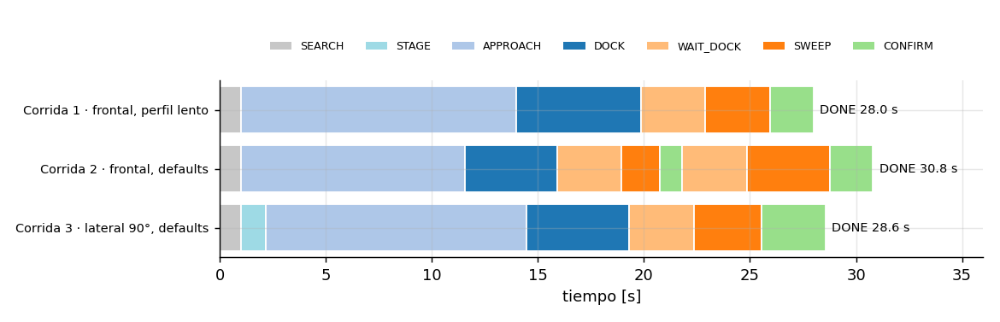
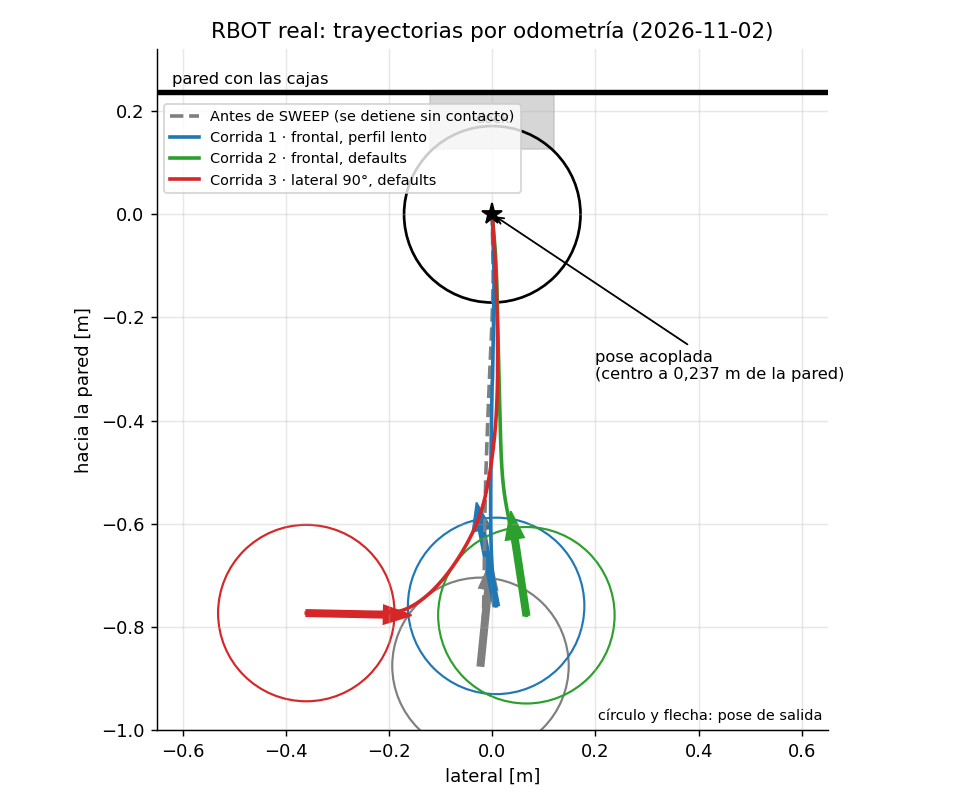
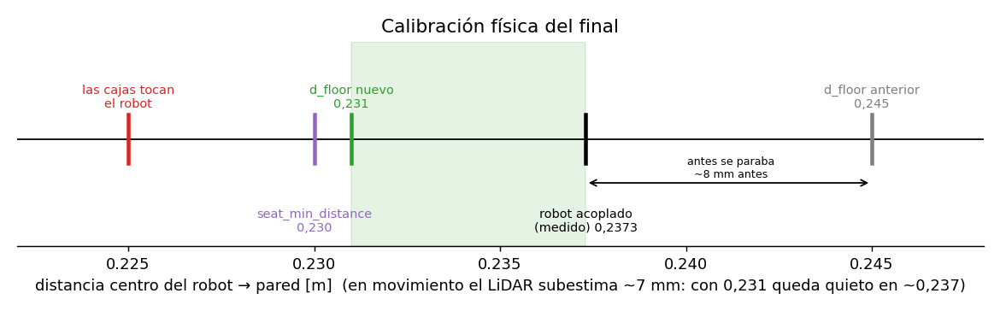
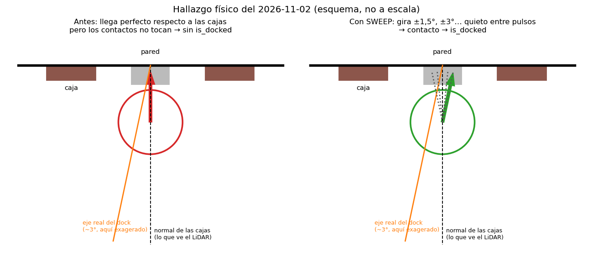
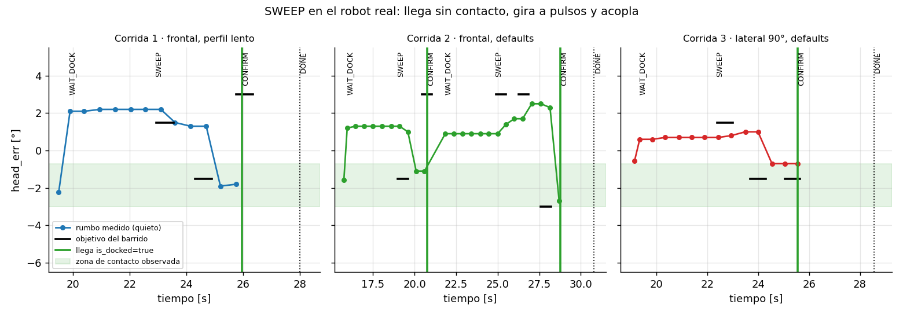

# La solución explicada para todos

*Cómo un robot aspiradora vuelve a su cargador "con los ojos vendados",
solo tanteando con un láser.*

> Esta es la versión sin fórmulas. La versión técnica completa está en el
> [README](README.md).

**Estado del RBOT físico (2026-11-02): ¡funciona en el robot real!** Tres
intentos seguidos, tres acoples con carga, incluso saliendo de costado. Ver
la [sección 9b](#9b-en-el-robot-real). Los cambios y pruebas están en la
[bitácora](docs/BITACORA_RBOT.md); hay 80 pruebas sin movimiento aprobadas.
Las métricas de Gazebo de la sección 9 son históricas.

**Cómo leer este documento:**
- **Parte 1 — La idea** (secciones 1 a 10): qué hace el robot y por qué, sin
  código.
- **Parte 2 — El código paso a paso**: fragmentos y explicaciones del nodo
  [`dock_lidar.py`](terraslam_solucion_dock_lidar/dock_lidar.py). Las referencias
  ℓ de la explicación original son históricas; buscar el nombre de la función
  en el archivo actual.
- **Parte 3 — Preguntas que les pueden hacer**: respuestas cortas para el jurado.

---

# Parte 1 — La idea

---

## 1. El problema en una frase

Hay que llevar un robot (un iRobot Create 3, la base de una Roomba) hasta
su cargador **usando únicamente un sensor láser**, sin los infrarrojos que
trae de fábrica para eso.

La trampa: **el robot no puede ver el cargador**. Es demasiado bajo para el
láser. Lo que sí ve son **dos cajitas** pegadas a la pared justo encima del
cargador. Si encuentra las cajitas, sabe dónde está el cargador.

```
        PARED
   ─────┬──┬─────┬──┬─────
        │▓▓│hueco│▓▓│        ← dos cajitas (8 cm) con un hueco (9,5 cm)
        └──┘     └──┘
          [CARGADOR]         ← justo debajo, centrado en el hueco
               ▲
               │
             robot
```

---

## 2. Qué "ve" el robot

El robot lleva encima un **LiDAR**: un láser que gira como un faro y mide la
distancia hasta lo primero que toca, **720 veces por vuelta, 10 vueltas por
segundo**.

No ve colores ni formas: solo recibe una lista de distancias. Es como estar
en un cuarto oscuro con un puntero láser que te dice "a 1,5 metros hay algo",
"a 1,52 metros hay algo"… en todas las direcciones.

Con esas distancias se puede dibujar el contorno del cuarto visto desde
arriba: paredes, esquinas… y las dos cajitas.

**Detalle importante:** el láser está montado **al revés** (girado 180°) y un
poco corrido hacia atrás y a la derecha. Si no se tiene en cuenta, el robot
creería que lo que tiene detrás está delante. La solución usa el sistema de
coordenadas de ROS (TF) para "enderezar" todas las mediciones antes de usarlas.

---

## 3. Cómo encuentra las cajitas

Imagina que pasas la mano por una pared a oscuras buscando **dos bloques
pegados, del mismo tamaño y con un hueco entre ellos**. Eso hace el robot con
los puntos del láser, en cuatro pasos:

1. **Encuentra las paredes.** Busca en los puntos las líneas rectas. Así
   salen la pared del fondo, las laterales, etc.
2. **Busca "bultos" en cada pared.** Puntos que sobresalen unos 8 cm de la
   pared, porque eso es lo que sobresalen las cajitas.
3. **Agrupa los bultos.** Los que están juntos forman un bloque; se descartan
   los que son más anchos que una cajita.
4. **Comprueba que el par sea el correcto.** Dos bloques solo se aceptan como
   "las cajitas" si pasan **todas** estas pruebas:

| Prueba | Por qué |
|---|---|
| Están separados exactamente como las cajitas reales (17,5 cm entre centros) | Dos objetos cualquiera casi nunca coinciden en eso |
| En el hueco no hay nada | Descarta un bloque ancho que se parezca a dos |
| Por el hueco se ve la pared | Confirma que están pegados a la pared |
| A los lados no hay nada raro | Descarta esquinas y columnas |
| Sobresalen 8 cm y son planos | Descarta superficies que no son cajas |
| Cada uno mide ~8 cm de ancho | Descarta cosas del tamaño equivocado |

Es como reconocer a alguien por varias señas a la vez: una sola puede
coincidir por casualidad, seis juntas casi nunca.

---

## 4. El truco de la precisión: los bordes

Cerca del cargador el margen es mínimo: el robot tiene que llegar **centrado
al milímetro y derecho**.

El problema es que los rayos del láser están separados. A 1,5 metros, entre
un rayo y el siguiente hay más de 1 cm. Si el robot tomara "el último rayo que
tocó la cajita" como su borde, se equivocaría hasta 7 mm, y siempre hacia el
mismo lado.

**El truco:** el borde real está en algún punto *entre* el último rayo que
toca la cajita y el primero que ya no la toca. Así que el robot toma **la
mitad exacta entre esos dos rayos**.

```
   rayo que toca      la mitad      rayo que no toca
          \              |              /
   cajita  ●─────────────✕             /      ✕ = borde estimado
                                      ●  (golpea la pared de atrás)
```

Hace esto con los **4 bordes** (2 por cajita), calcula el centro de cada
cajita y promedia los dos centros: **ahí está el eje del cargador**.

Con esto, un solo vistazo del láser ya ubica el cargador con **alrededor de
1 mm** de error, y menos cuanto más cerca está el robot.

---

## 5. La memoria: no fiarse de un solo vistazo

Cada medición trae un poquito de ruido, y a veces el robot no ve bien las
cajitas: por un ángulo raro, porque está demasiado cerca o porque algo las
tapa. Por eso el robot **recuerda** dónde vio el cargador y va mejorando esa
estimación con cada vistazo nuevo.

Funciona como pedir indicaciones a varias personas y confiar más en la que
está más cerca del lugar:

- Las mediciones **de cerca pesan más** que las de lejos, porque son más
  precisas.
- Si una medición no tiene sentido comparada con lo que ya sabe, **la ignora**.
- Si deja de ver las cajitas un momento, **sigue guiándose por lo que
  recuerda** y por lo que sabe de sus propios movimientos.

A esto se le llama **filtro de Kalman**.

---

## 6. Cómo se mueve: como estacionar un auto

Una vez sabe dónde está el cargador, el robot se imagina una **línea recta
que sale del cargador, perpendicular a la pared**, e intenta montarse sobre
ella.

La técnica se llama **"persecución de un punto"** (*pure pursuit*): el robot
no apunta al cargador directamente, sino a **un punto de esa línea un poco
más adelante**. Es lo que haces al manejar: miras un poco más allá del auto,
no justo delante del parachoques. Así corrige el rumbo suave y a la vez se va
centrando.

```
            CARGADOR
               │
               │  ← línea imaginaria
               ✕  ← punto al que apunta (se acerca a medida que avanza)
              /│
             / │
         robot │
```

A medida que se acerca, ese punto se acerca también, así que la corrección se
vuelve más fina justo cuando más importa.

**La velocidad cambia por tramos:**

| Tramo | Velocidad | Por qué |
|---|---|---|
| Lejos | hasta 14 cm/s por defecto | Aproximación; tope absoluto de 20 cm/s |
| Desde 75 cm de la pared | 5 cm/s por defecto | Centrarse y enderezarse con calma |
| Rampa del cargador | 2,5 cm/s | Si sube rápido, rebota |

En el ensayo frontal pendiente se usarán 8/3 cm/s y tramo fino desde 80 cm,
sin reintentos ni pulsos. El límite angular absoluto es 0,50 rad/s en todos
los estados; el perfil usa como máximo 0,40 rad/s.

En la simulación histórica, a velocidad tan baja, los giros
pequeñitos que pide el robot no alcanzaban a vencer la fricción de las
ruedas, y quedaba un poquito torcido. Se agregó una corrección que **va
sumando ese error hasta que las ruedas responden** (la parte "integral" del
control). Con eso el error final bajó de ~1° a ~0,1° en aquella simulación.
En el RBOT se conserva `k_i=0.0`, la configuración que funcionó para el equipo.

---

## 7. Los "modos" del robot

El robot siempre está en uno de estos modos y cambia según lo que pasa:

| Modo | Qué hace | Cuándo |
|---|---|---|
| **SEARCH** (buscar) | Espera y gira un poco | Al arrancar, mientras no ha visto las cajitas |
| **EXPLORE** (explorar) | Se mueve hacia el centro del espacio libre | Si no ve las cajitas: están tapadas o las ve demasiado de canto |
| **STAGE** (prepararse) | Va primero a un punto frente al cargador | Si está muy de costado y muy cerca de la pared para entrar directo |
| **APPROACH** (acercarse) | Sigue la línea imaginaria | El modo normal |
| **DOCK** (acoplar) | Sube la rampa despacito | Los últimos centímetros |
| **BACKOFF** (retroceder) | Recuperación con presupuesto y tiempo limitados | Si llega desalineado cerca o después de ESCAPE |
| **ESCAPE** (despegarse) | Retrocede recto | Si el parachoques detecta un choque |
| **WAIT_DOCK** (esperar) | Permanece parado hasta 3 s | Al llegar alineado a 23,1 cm de la pared o agotar el tiempo de DOCK |
| **SWEEP** (girar buscando contacto) | Gira en el sitio a pequeños pasos (±1,5°, ±3°… hasta ±6°), parando quieto 1,2 s en cada uno | Si llegó a la distancia de acople y centrado, pero no aparece el `true` |
| **CONFIRM** (confirmar) | Permanece parado | Desde el primer true; exige al menos tres mensajes que abarquen 2 s |
| **DONE** (listo) | Mantiene ceros y vigila el estado | Tras confirmar contacto estable |
| **STOPPED** (detenido) | Mantiene ceros hasta relanzar | Si falta información, se pierde contacto confirmado o se agota un límite |

SEAT permite pulsos finales experimentales, pero están desactivados por
defecto: aún no se han validado físicamente.

---

## 8. Qué pasa si algo sale mal

| Problema | Qué hace el robot |
|---|---|
| No ve las cajitas | Se mueve hacia el centro de la zona despejada (lejos de las paredes) y vuelve a mirar. Desde el centro las cajitas se ven de frente. |
| Deja de verlas un momento | Usa el filtro durante un tiempo limitado; en el tramo final exige un plano reciente del muro. |
| Llega al cargador torcido o descentrado | Reintenta si queda presupuesto; si no, se detiene. |
| Llega alineado a la distancia mínima | Espera parado el estado; no retrocede por agotar esa espera. |
| Llega bien pero no hace contacto | Gira de a poquito a cada lado (SWEEP) hasta que el robot diga "cargando". El dock real está girado unos 3° respecto a las cajitas. |
| Recibe un BUMP | Recuperación limitada durante aproximación; parada sin retroceso durante WAIT_DOCK/SEAT. Depende de que llegue el tópico. |
| Recibe true y después false | Reinicia la confirmación; si ya había terminado, queda en STOPPED. |
| Pierde LiDAR, TF o estado | Se detiene y requiere relanzar. |

---

## 9. ¿Qué tan bien funciona? (simulador)

Se probó en el simulador desde **20 posiciones al azar**, dentro de la zona
donde el jurado pone el robot (incluso de espaldas al cargador):

| | Resultado |
|---|---|
| Veces que llegó al cargador | **20 de 20** |
| Choques | **ninguno** |
| Tiempo promedio | **16,7 segundos** (el máximo permitido es 180, y el puntaje de tiempo es completo hasta 45) |
| Qué tan centrado quedó | **0,1 mm** de error en promedio (el grosor de una hoja de papel) |
| Qué tan derecho quedó | **0,12°** de error en promedio (el simulador acepta hasta 6°) |

---

## 9b. En el robot real

El 2026-11-02 probamos en el robot de verdad (un Create 3 con su LiDAR, en el
laboratorio de Kalman, conectados a distancia). Cada intento lo autorizó el
operador por separado.

| Intento | Desde dónde salió | Cuánto tardó | ¿Cargó? |
|---|---|---|---|
| 1 (despacio) | De frente, a 0,9 m, un poco torcido | 28,0 s | ✅ |
| 2 (configuración final) | De frente, a 0,9 m | 30,8 s | ✅ |
| 3 (configuración final) | **De costado**: mirando paralelo a la pared, 38 cm corrido | 28,6 s | ✅ |

Así se repartió el tiempo de cada intento (cada color es un "modo" de la
sección 7):



Y este es el camino que hizo el robot visto desde arriba. Los tres terminan
exactamente en el mismo punto, aunque salieron de lugares distintos:



### El misterio de los "unos centímetros que faltaban"

Al principio el robot hacía todo perfecto… y se paraba justo antes de
cargar. Descubrimos **dos cosas**:

**1. Se frenaba demasiado pronto.** Le habíamos dicho "frena a 24,5 cm de la
pared", pero el robot cargando queda a 23,7 cm. Lo medimos poniéndolo a mano
en el cargador. Ahora frena a 23,1 cm (el láser mide con un poquito de
retraso, así que en realidad queda quieto justo en 23,7).



**2. El cargador está un poquito girado.** El láser no ve el cargador, solo
las cajitas. Y en el laboratorio el cargador está girado unos 3° respecto a
las cajitas: como un cuadro torcido en la pared. El robot llegaba perfecto
respecto a las cajitas… y por eso los contactos de carga no se tocaban.



**La solución: SWEEP ("barrer").** Si llega bien pero no carga, gira un
poquito a un lado, se queda quieto, pregunta "¿estoy cargando?", gira un
poquito al otro, y así: ±1,5°, ±3°… hasta ±6°. Como cuando uno mete una
llave que no entra y la mueve apenas hasta que calza. No le decimos "está a
3°": así funciona aunque en la final coloquen el cargador distinto.

En el gráfico: los puntos son hacia dónde mira el robot, las rayitas negras
son los giros que intenta, y la línea verde es el momento en que el robot
dice "¡estoy cargando!". En los tres intentos bastaron unos 3 segundos de
barrido:



En el intento 2 el robot dijo "cargando" un instante y después "no". El modo
CONFIRM (sección 7) no se dejó engañar: exige 2 segundos seguidos de
"cargando" estando quieto. Siguió barriendo y a los pocos segundos acopló de
verdad. Después de ese intento le enseñamos un truco más: si el contacto fue
fugaz, volver primero al ángulo exacto donde lo tuvo.

---

## 10. Las reglas que respetamos

- ✅ Solo se usa el **láser** para ubicar el cargador.
- ✅ **Nada escrito "a mano"**: el robot no sabe de antemano dónde está el
  cargador ni sigue una ruta fija. Lo único que conoce son las **medidas de
  las cajitas**, que los organizadores publican justamente para eso.
- ❌ No se usa la función automática de acoplar del robot (`/dock`).
- ❌ No se usan los infrarrojos.
- ❌ No se usa la posición "real" que conoce el simulador.
- ✅ No se modificó nada del escenario oficial.

---

# Parte 2 — El código paso a paso

Todo está en **un solo archivo**:
[`terraslam_solucion_dock_lidar/dock_lidar.py`](terraslam_solucion_dock_lidar/dock_lidar.py).
Los números ℓ se conservaron de la explicación original y ya no coinciden
con el archivo actual. El mapa usa nombres de funciones para localizar el
código. Los fragmentos con `...` son esquemas abreviados, no código ejecutable.

## Mapa del archivo

| Símbolo actual | Pieza | En una frase |
|---|---|---|
| `DockDetector` | **Detector** | Encuentra las cajitas en un scan. Usa NumPy y se puede probar aparte. |
| `DockFilter` | **Memoria** | Recuerda el eje del cargador. |
| `DockLidar.__init__`, `check_params` | **Configuración** | Parámetros ajustables desde el launch. |
| `on_scan`, `on_dock`, `on_hazard` | **Oídos** | Recibe scan, estado o choque. |
| `recent_wall_distance` | **Distancia final** | Evalúa planos recientes del muro con la pose actual. |
| `on_timer`, `seating_step` | **Cerebro** | Decide el estado, comprueba límites y manda movimiento o ceros. |
| `sweep_eligible`, `start_sweep`, `sweep_tick` | **Barrido** | Gira a pulsos buscando el contacto cuando llega sin `true` (C12). |
| `cmd` | **Salida** | Aplica límites absolutos, dry-run y parada. |
| `main` | **Arranque y cierre** | Arranca el nodo, publica ceros al cerrar y sale limpio con Ctrl-C. |

Dos "relojes" mueven todo:

```
cada scan del láser (10 por segundo) ──► on_scan (ℓ672): ¿dónde está el cargador?
cada tick del control (20 por segundo) ─► on_timer (ℓ731): ¿cómo me muevo?
```

---

## C1. Las únicas medidas que conoce el robot (ℓ91)

```python
BOX_W = 0.080                  # ancho de cada cajita: 8 cm
BOX_D = 0.080                  # cuánto sobresale de la pared: 8 cm
GAP = 0.095                    # hueco entre cajitas: 9,5 cm
PITCH = BOX_W + GAP            # 0.175 entre centros de caja
```

Son las medidas de las cajitas que publica el reto. **No hay ninguna
posición del mundo en el código**: ni dónde está el cargador ni dónde
arranca el robot. Todo lo demás se mide con el láser.

---

## C2. Del láser a puntos en el robot (ℓ672 `on_scan`)

Cuando llega un scan, lo primero es convertir las 720 distancias en puntos
`(x, y)` vistos desde el centro del robot:

```python
tf = self.lookup(self.base_frame, msg.header.frame_id)   # dónde está montado el láser
self.laser_tf = tf_to_pose2d(tf)                         # (posición, giro) del láser
...
ang = msg.angle_min + np.arange(r.size) * msg.angle_increment   # ángulo de cada rayo
ok = np.isfinite(r) & (r > msg.range_min) & ...                 # descartar lecturas inválidas
dirs = np.stack([np.cos(a), np.sin(a)], 1) @ R.T                # dirección de cada rayo, girada
pts = r[ok][:, None] * dirs + t_l                               # punto = origen + distancia × dirección
```

- `lookup(...)` le pregunta a ROS (TF) **cómo está montado el láser**: 5 cm
  atrás, 1,8 cm a la derecha y girado 180°.
- `@ R.T` **gira** cada rayo según ese montaje, y `+ t_l` lo **corre** desde
  el láser hasta el centro del robot.
- Resultado: `pts` son los puntos como si el robot los viera desde su
  centro, mirando al frente. Por eso al código no le importa que el láser
  esté al revés.

---

## C3. Encontrar las paredes (ℓ151 `ransac_lines`)

```python
for _ in range(max_lines):                  # hasta 6 paredes
    ...
    for i, j in zip(a, b):                  # 60 intentos: pares de puntos al azar
        d = pts[j] - pts[i]
        nrm = np.array([-d[1], d[0]]) / L   # perpendicular a la recta que pasa por i y j
        dist = np.abs((pts[cand] - pts[i]) @ nrm)   # distancia de cada punto a esa recta
        k = int((dist < tol).sum())         # ¿cuántos puntos quedan pegados a la recta?
        if k > best_n:
            best_n, best = k, (pts[i], nrm) # me quedo con la recta que más puntos junta
    ...
    c, nrm = _fit_line(pts[inl])            # la ajusto bien con todos sus puntos
    lines.append((c, nrm, inl))
    free &= ~inl                            # quito esos puntos y busco la siguiente pared
```

Es como probar muchas reglas apoyadas en dos puntos al azar y quedarse con
la que toca más puntos. Esa es una pared. Se quitan sus puntos y se repite.
Esto se llama **RANSAC**.

---

## C4. Buscar los "bultos" de 8 cm (ℓ232 `_try_line`)

Para cada pared, cada punto recibe dos coordenadas: `h` (cuánto sobresale
de la pared) y `s` (dónde está a lo largo de ella).

```python
h = rel @ nrm          # altura sobre la pared (hacia el robot)
s = rel @ tan          # posición a lo largo de la pared
...
prot = (h > BOX_D - band) & (h < BOX_D + band) & ...     # ℓ249: sobresalen ~8 cm
...
groups = [pidx[order][g] for g in _runs(ps, 0.035)]      # ℓ256: agrupar si están a < 3,5 cm
for g in groups:
    w = s[g].max() - s[g].min()                           # ancho del grupo
    if g.size >= 2 and w <= BOX_W + ...:                  # ¿cabe en una cajita?
        boxes.append(g)
```

- `prot` marca los puntos que sobresalen unos 8 cm: candidatos a cara
  frontal de una cajita.
- `_runs` los corta en grupos donde hay un salto grande.
- Solo quedan los grupos del **ancho de una cajita** o menos.

---

## C5. Las pruebas del par (ℓ276 `_pair`)

Aquí se decide si dos grupos son **las cajitas**. Cada `return None` es una
prueba que, si falla, descarta el par:

```python
sep = cb - ca                                         # distancia entre centros
if abs(sep - PITCH) > 0.035:                          # ℓ281  prueba 1: ¿17,5 cm ± 3,5?
    return None
...
if np.any(in_gap & (h > hmin) & (h < 0.30)):          # ℓ290  prueba 2: ¿el hueco está vacío?
    return None
if np.any(out & (h > hmin) & (h < 0.30)):             # ℓ293  prueba 4: ¿nada a los lados?
    return None
if not np.any(in_gap & (np.abs(h) < ...)):            #       prueba 3: ¿se ve pared en el hueco?
    ...                                               #       (o pared a ambos lados si es muy oblicuo)
...
if abs(off - BOX_D) > ... or rms > ...:               #       prueba 5: ¿sobresalen 8 cm y son planas?
    return None
...
if abs(wa - BOX_W) > wt or abs(wb - BOX_W) > wt:      #       prueba 6: ¿cada una mide ~8 cm?
    return None
```

Entre las pruebas 4 y 5 está el **ajuste fino** (ℓ310): la pared cercana y
las caras de las cajitas se ajustan juntas como **dos rectas paralelas**. Se
hace en dos pasadas, cada vez más estrictas, para que no se cuelen los
puntos de los **costados** de las cajitas, que se ven mucho cuando el robot
las mira de lado.

Al final (ℓ355):

```python
centers_s = [mitad de los bordes de la caja 1, mitad de los bordes de la caja 2]
axis_s = float(centers_s.mean())      # el eje del cargador: el medio entre los dos centros
wall_pt = wall_c + axis_s * t2        # el punto de la pared donde está ese eje
```

Si hay varios pares que pasan, gana el de mejor **puntaje**: más puntos,
separación más exacta, ajuste más limpio y más cerca de donde el robot
recordaba el cargador.

---

## C6. El truco de los bordes (ℓ373 `_box_edges`)

```python
k = g[np.argmax(s[g])]                 # el último punto que toca la cajita (por ese lado)
for nb in (k - 1, k + 1):              # su rayo vecino
    if (s[nb] - s_in) * side <= 0.001: # el vecino tiene que quedar FUERA de la cajita
        continue
    if side_tol < h[nb] < off - side_tol and ...:
        best = s[nb]                   # cayó en el costado de la caja: ese punto ES el borde
        break
    d = dirs[k] + dirs[nb]             # la bisectriz: la mitad entre los dos rayos
    lam = (off - o_h) / (d @ n)        # ℓ401  cuánto hay que avanzar por ella hasta la cara frontal
    best = o_s + lam * (d @ t)         # ahí está el borde
```

- Sumar las dos direcciones (`dirs[k] + dirs[nb]`) da la dirección **del
  medio**, la bisectriz.
- `lam` es cuánto hay que avanzar por esa dirección, desde el láser, hasta
  chocar con la cara frontal de la cajita. Ese punto de corte es el borde.
- Se hace para los 2 bordes de cada cajita: 4 bordes en total.

---

## C7. La memoria: filtro de Kalman (ℓ435 `DockFilter`)

Guarda **dónde está el cargador** (`p`), **hacia dónde mira la pared**
(`a`) y **cuánta duda tiene** de cada cosa (`Pp`, `Pa`).

```python
def predict(self, ds, dth):                          # ℓ452: cada vez que el robot se mueve
    self.Pp += (0.01 * ds) ** 2 + (0.02 * abs(dth)) ** 2    # ...la duda crece un poquito

def update(self, p, a, sp, sa):                      # ℓ459: cada vez que ve las cajitas
    dp = p - self.p                                  # ¿cuánto difiere de lo que recordaba?
    gate_p = 4.0 * math.sqrt(self.Pp + sp ** 2) + 0.02
    if np.linalg.norm(dp) > gate_p ...:              # ℓ467: ¿difiere demasiado?
        self.rejects += 1                            #   la ignora...
        if self.rejects >= 5:                        #   ...salvo que pase 5 veces seguidas:
            self.p = p.copy() ...                    #   entonces el que estaba mal era yo
        return False
    kp = self.Pp / (self.Pp + sp ** 2)               # ℓ478: cuánto creerle (0 = nada, 1 = todo)
    self.p = self.p + kp * dp                        # mezcla: lo que sabía + parte de lo nuevo
    self.Pp *= (1 - kp)                              # y ahora dudo menos
```

- `kp` es la clave: si el robot **duda mucho** de lo que recuerda (`Pp`
  grande) y la medición es **buena** (`sp` chico), `kp` se acerca a 1 y le
  cree a la medición nueva. Si pasa al revés, casi la ignora.
- La calidad de cada medición depende de la distancia (ℓ710):

```python
sp = 0.0008 + 0.0025 * rng_m + 1.5 * d.residual   # duda de la medición: crece con la distancia
```

  Por eso las mediciones de cerca, las más precisas, son las que mandan al
  final.
- Antes de guardarla, la medición se pasa al marco fijo `odom` con la
  posición del robot **en el instante del scan** (ℓ713). Así no importa que
  el robot se haya movido mientras se procesaba.

---

## C8. El cerebro: qué hacer en cada tick (ℓ731 `on_timer`)

Se ejecuta 20 veces por segundo con reloj monotónico. Esquema del orden:

```python
if self.state == 'STOPPED': ...             # ceros, sin rearmar
if self.state == 'DONE': ...                # ceros y comprobar contacto fresco
...                                         # límite de tiempo total y datos frescos
pose = self.robot_pose()                    # odometría/TF
self.filt.predict(ds, dth)                  # incertidumbre por movimiento
if self.state == 'CONFIRM': ...             # ceros; verificar mensajes y duración
if self.bump_pending is not None: ...       # recuperación limitada o parada
if not self.filt.valid: ...                 # buscar / explorar
d = float((p - W) @ n)                      # distancia filtrada a la pared
e = float((p - W) @ t)                      # lateral respecto al eje filtrado
...                                         # sustituir d por planos recientes al final
...                                         # WAIT_DOCK o estado de maniobra
```

`d` y `e` son los dos números que guían todo:
- **`d`**: cuánto le falta al robot para llegar a la pared, medido
  perpendicular a ella.
- **`e`**: cuánto está corrido a la izquierda o a la derecha del eje del
  cargador. El objetivo es `e = 0`.

La decisión actual de reintentar distingue desalineación y llegada alineada:

```python
misaligned = abs(e) > self.tol_lat or abs(head_err) > self.tol_head   # > 2,5 cm o > 15°
if close and misaligned:
    self.retry(...)                               # presupuesto limitado; si no, STOPPED
    return
if d <= self.d_floor:                              # llegada alineada
    self.set_state('WAIT_DOCK')                    # esperar parado, sin retroceso
    self.cmd()
    return
```

`on_dock` detiene desde el primer true y entra en CONFIRM. No empuja para
confirmar: exige tres mensajes nuevos true que abarquen al menos 2 s. En el
tramo final, `d` se calcula con los planos recientes aceptados, mientras `e`
y el rumbo conservan el filtro anterior.

---

## C9. La ley de movimiento (ℓ941 `follow_axis`)

Aquí está lo que hace que llegue centrado al milímetro:

```python
L = float(np.clip(0.35 * (d - 0.26), 0.05, 0.50))   # ℓ952: a qué distancia adelante apuntar
th_des = wrap(th_wall + math.atan2(e, L))           # ℓ958: rumbo deseado
err = wrap(th_des - th)                             # cuánto me falta girar
self.i_err = float(np.clip(0.97 * self.i_err + err * dt, -0.02, 0.02))   # ℓ969: error acumulado
w = self.k_w * err + self.k_i * self.i_err          # velocidad de giro
```

- **`L`** es qué tan adelante, sobre la línea imaginaria, está el punto al
  que apunta el robot: hasta 50 cm cuando está lejos y 5 cm cuando está
  cerca.
- **`th_des`**: "mira a la pared (`th_wall`), pero desviado lo necesario para
  volver a la línea (`atan2(e, L)`)". Si `e = 0`, mira derecho a la pared.
- **`w = k_w · err + k_i · i_err`**: gira proporcional a lo que le falta
  (`k_w`), más el error acumulado (`k_i`). El acumulado vence la fricción de
  las ruedas cuando va muy lento. El `0.97` hace que ese acumulado se vaya
  "olvidando" para no pasarse.

La velocidad por tramos:

```python
if d < self.d_dock:   v = self.v_dock      # rampa: 2,5 cm/s
elif d < self.d_fine: v = self.v_fine      # últimos 60 cm: 5 cm/s
else:                 v = ...              # lejos: hasta v_max (14 cm/s por defecto)
v *= max(0.0, math.cos(err)) ** 4 if abs(err) < 1.0 else 0.0   # ℓ987
```

La última línea dice: **si estoy mal orientado, frena**. Con un error de
rumbo de más de ~57° (1 radián) se para y solo gira.

---

## C10. Explorar cuando no ve las cajitas (ℓ892 `explore_target`)

```python
P = pts[np.argsort(ang)]                          # puntos del scan ordenados en círculo
cross = x * yn - xn * y
area = 0.5 * cross.sum()                          # área del "polígono" de lo que ve libre
c = np.array([((x + xn) * cross).sum(), ...]) / (6.0 * area)   # ℓ913: su centro
step = min(self.explore_step, dist)               # avanzar hasta 0,8 m...
return pos + rot(yaw) @ (c / dist * step)         # ...hacia ese centro
```

Los puntos del láser, unidos en orden, dibujan un polígono con la forma del
espacio libre alrededor del robot. Su **centro de área** (la fórmula clásica
del centroide de un polígono) es el centro de la zona despejada. Ir hacia
allí aleja al robot de las paredes, y desde ahí las cajitas se ven de
frente.

---

## C11. Reaccionar a un choque (ℓ661 `on_hazard`)

`on_hazard` solo usa BUMP y cuenta un contacto persistente como un evento.
Durante la aproximación se procesa una recuperación `ESCAPE → BACKOFF` si
queda presupuesto; al agotarlo se detiene. Durante WAIT_DOCK/SEAT se detiene
sin retroceder. CONFIRM, DONE y STOPPED mantienen ceros. No se ignoran nuevos
choques para seguir avanzando tras agotar el límite.

Esta reacción depende de que llegue `/hazard_detection`: el diagnóstico
físico anterior no encontró un publicador de ese tópico. El límite global
por defecto es de dos recuperaciones y el de eventos BUMP es de tres; ambos
se aplican, además del tiempo máximo por recuperación.

---

## C12. Girar buscando el contacto (`start_sweep`, `sweep_tick`)

Se activa en WAIT_DOCK si pasaron 3 s sin `true`, el robot está a la
distancia de contacto (hasta 1,5 cm más allá de `d_floor`) y centrado
(lateral ≤ 2 cm). Primero arma la lista de rumbos a probar, del más chico al
más grande, alternando lados:

```python
n = max(1, int(round(self.sweep_max / self.sweep_step)))      # 6° / 1,5° = 4
self.sweep_targets = [sign * k * self.sweep_max / n
                      for k in range(1, n + 1) for sign in (1, -1)]
# -> +1,5  -1,5  +3  -3  +4,5  -4,5  +6  -6   (en grados)
```

Después, en cada tick alterna dos fases: **pulso** (gira a 0,3 rad/s, sin
avanzar, durante 0,1–0,5 s) y **pausa** (quieto 1,2 s). Solo al terminar la
pausa mira el rumbo y decide:

```python
target = self.sweep_targets[self.sweep_idx]
err = target - head_err                    # cuánto falta para ese rumbo
if abs(err) <= math.radians(0.5) or self.sweep_tries >= 3:
    self.sweep_idx += 1                    # llegó (o no se puede): el siguiente
...
duration = float(np.clip(abs(err) / self.sweep_w, 0.1, 0.5))
self.sweep_pulse = (math.copysign(1.0, err), duration)
```

Para todo `true` que llega, `on_dock` manda ceros al instante y pasa a
CONFIRM. Como el estado llega con ~0,2 s de retraso, si llegó durante un
pulso guarda el rumbo **quieto de antes del pulso**: si el `true` resulta
fugaz, al reanudar vuelve primero a ese rumbo (como máximo dos veces).

Límites: nunca avanza (`v = 0`), nunca pasa de ±6°, 25 s como máximo; si se
sale del eje (lateral > 3 cm), recibe un choque o agota la lista, se detiene
**sin retroceder**. Se desactiva con `dock_sweep:=false`.

---

# Parte 3 — Preguntas que les pueden hacer

**¿Por qué el robot gira un poco al llegar al cargador?**
Porque en el laboratorio el cargador está girado unos 3° respecto a las
cajitas: lo medimos el 2026-11-02 con el robot acoplado a mano. El robot
llega perfectamente alineado con las cajitas (que es lo único que el LiDAR
puede ver) y, si no hay contacto, prueba rumbos +1,5°, −1,5°, +3°, −3°…
hasta ±6° (estado `SWEEP`, funciones `start_sweep` y `sweep_tick`). No
guardamos "el cargador está a +3°": así funciona aunque lo coloquen distinto.

**¿Por qué gira a pulsos y no de forma continua?**
El estado del cargador (`/dock_status`) llega una vez por segundo y la
conexión con el robot tiene latencia. Con un giro continuo se pasaría del
punto de contacto. Da un pulso corto, se queda quieto 1,2 s, lee el estado y
mide el rumbo ya asentado; recién entonces decide el siguiente pulso.

**¿Funcionó en el robot real?**
Sí. El 2026-11-02 hicimos tres intentos seguidos en el Create 3 del
laboratorio y los tres acoplaron y cargaron: 28,0 s, 30,8 s y 28,6 s, el
último saliendo de costado (90° respecto al cargador y 38 cm corrido). Dos
de ellos con la configuración exacta que se entrega. Los registros están en
`docs/pruebas/` y los gráficos en la sección 9b.

**¿Usan alguna posición fija del mundo?**
No. Las únicas constantes son las medidas de las cajitas (ℓ91), que el reto
publica para eso. Las distancias de la maniobra (`d_fine`, `d_dock`, …) se
miden desde la pared **detectada**, no desde coordenadas del mundo.

**¿Cómo saben que lo que ven son las cajitas y no otra cosa?**
Por 6 pruebas geométricas simultáneas en `_pair` (ℓ276): separación exacta,
hueco vacío, pared visible en el hueco, nada a los lados, saliente de 8 cm
y planitud, y ancho de 8 cm. Una esquina o una columna no pasan todas a la
vez.

**¿Qué pasa con el láser montado al revés?**
Todos los puntos se transforman con TF al marco del robot antes de usarlos
(ℓ686). El código nunca asume que el rayo 0 apunta al frente.

**¿Cómo logran precisión de milímetros si los rayos están separados más de 1 cm?**
Triangulando cada borde con la bisectriz entre el último rayo que toca la
cajita y el primero que no (ℓ373–401), y promediando los 4 bordes (ℓ355).
Además, el filtro de Kalman combina muchas mediciones y confía más en las
cercanas (ℓ710).

**¿Por qué un filtro de Kalman y no solo la última medición?**
Porque una medición aislada tiene ruido y a veces falla. El filtro descarta
las que no cuadran (ℓ467), pesa cada una según su calidad (ℓ478) y mantiene
la estimación si se pierden las cajitas un momento.

**¿Qué pasa si el robot pierde de vista las cajitas?**
Sigue guiado por el filtro y la odometría. Si nunca las vio, explora hacia
el centro del espacio libre (ℓ892) hasta encontrarlas.

**¿Por qué va tan lento al final?**
Para que el error lateral y el angular lleguen a cero antes de la rampa
(ℓ952: el punto al que apunta se acorta a 5 cm), y porque en la rampa, si
entra rápido, rebota.

**¿Para qué sirve el término integral?**
A 2–5 cm/s, los giros pequeñitos no alcanzan a vencer la fricción de las
ruedas. El integral (ℓ969) acumula ese error hasta que las ruedas responden.
Con él, el error angular final bajó de ~1° a ~0,1°.

**¿Cómo saben que llegaron?**
Por `/dock_status`, campo `is_docked`, con tres mensajes nuevos true que
abarquen al menos 2 s, mientras permanece parado. Si se pierde después, queda
en STOPPED. No se usa `dock_visible`, porque sale de los infrarrojos.

**¿Qué pasa si choca?**
Si llega BUMP por `/hazard_detection`, hace una recuperación limitada durante
la aproximación o se detiene durante WAIT_DOCK/SEAT. Ver C11 y la bitácora
para la disponibilidad del tópico en el RBOT.

**¿Qué pasa si llega torcido?**
Si al pasar a 42 cm de la pared está a más de 2,5 cm del eje o a más de 15°,
retrocede y reintenta (ℓ826), en lugar de forzar la entrada.

**¿Por qué todo en un solo archivo?**
Porque las bases piden un nodo y un launch. Por dentro está separado en
piezas independientes: el detector, por ejemplo, no depende de ROS y se
probó aparte con miles de scans simulados.

**¿Cómo lo probaron?**
La validación histórica usó un simulador 2D para el detector (400 poses por prueba) y
Gazebo completo: 20 poses al azar del rango del jurado, 20 de 20 acoplados,
sin choques, 16,7 s de promedio. El "ground truth" solo se usó en los scripts
de prueba, nunca en la solución. Después, en el robot real: tres acoples de
tres (sección 9b). Además hay 80 pruebas automáticas sin robot que verifican
la seguridad (límites de velocidad, paradas, el barrido).

**¿Qué ajustarían para el robot real?**
Los valores por defecto ya son físicos: `use_sim_time=false`,
`range_sigma=0.01`, velocidades 0.14/0.05 m/s y `k_i=0.0`, con límites
absolutos de 0.20 m/s y 0.50 rad/s. Lo que cambió con el robot real: la
distancia de frenado se calibró con el robot cargando (23,1 cm) y se añadió
el barrido SWEEP porque el cargador está girado respecto a las cajitas.

---

## Cómo correrlo

Se necesitan dos terminales:

```bash
# Terminal 1: el escenario del reto
ros2 launch create3_dock_challenge challenge_world.launch.py

# Terminal 2: nuestra solución
ros2 launch terraslam_solucion_dock_lidar solucion.launch.py
```

El robot arranca solo, se acopla y se detiene. No hay que tocar nada más.

---

## Mini glosario

| Término | En simple |
|---|---|
| **LiDAR** | Láser giratorio que mide distancias en todas las direcciones. |
| **ROS 2** | El "sistema operativo" que conecta las piezas del robot: sensores, motores, programas. |
| **Nodo** | Un programa dentro de ROS. Nuestra solución es un solo nodo, `dock_lidar`. |
| **Tópico** | Un "canal" por donde los nodos se pasan información. El láser publica en `/scan` y nosotros mandamos las velocidades por `/cmd_vel`. |
| **TF** | El sistema que sabe dónde está cada pieza del robot respecto a las demás (por ejemplo, dónde está montado el láser). |
| **Odometría** | Lo que el robot calcula de su propio movimiento contando vueltas de rueda. Se va desviando con el tiempo. |
| **RANSAC** | Método para encontrar líneas rectas en un montón de puntos, aunque haya puntos que no pertenezcan a ninguna. |
| **Filtro de Kalman** | Método para combinar muchas mediciones con ruido y obtener una estimación mejor que cualquiera de ellas sola. |
| **Pure pursuit** | Técnica para seguir una línea apuntando a un punto un poco más adelante sobre ella. |
| **Control integral** | Corrección que va acumulando un error pequeño que no se va solo, hasta eliminarlo. |
| **Launch** | Archivo que arranca el nodo con su configuración. Es el "comando único" que pide el reto. |
